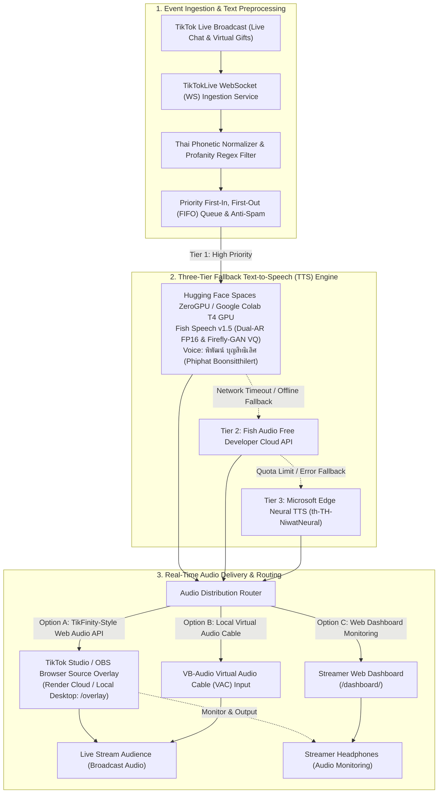

# 🎙️ TikTok Live Text-to-Speech (TTS) Bot & Cloud Web Platform

[](https://colab.research.google.com/drive/1f4t-Q0H9QRwQwK4XlJS_DHwfsRPkEMz1)
[](huggingface-space/)
[](https://render.com/deploy?repo=https://github.com/PhuriphatTyPeZ3r0/tiktok-live-tts-bot)
[](https://www.python.org/)
[](LICENSE)
[](tests/)
[](https://fastapi.tiangolo.com/)
[](https://developers.cloudflare.com/cloudflare-one/connections/connect-networks/)

High-performance, zero-cost, and robust asynchronous Text-to-Speech (TTS) bot and multi-tenant cloud platform for TikTok LIVE streamers. Converts incoming live chat comments and monetary gift events into real-time speech using a serverless **Hugging Face Spaces Zero-cost Graphics Processing Unit (ZeroGPU)** or self-hosted **Google Colaboratory (Colab)** Fish Speech v1.5 backend, backed by an automated 3-tier fallback engine (Fish Audio Free Developer Tier and Microsoft Edge Neural Text-to-Speech). Audio is delivered seamlessly via a **TikFinity-style Browser Source Overlay** (no Virtual Audio Cable driver required) or locally through a Virtual Audio Cable (VAC). Fully deployable 100% free ($0/month) on **Render Free Web Service** and **Hugging Face Spaces ZeroGPU**.

---

## 🎭 Voice Model Attribution (ผู้ให้เสียงต้นฉบับ)

> 🎙️ **Official Voice Attribution:**  
> โมเดลเสียงพากย์ปัญญาประดิษฐ์ (Artificial Intelligence: AI Voice Clone) ในโครงงานนี้ ได้รับการเทรนและสังเคราะห์จากเสียงของ **"พิพัฒน์ บุญสิทธิเลิศ (Phiphat Boonsitthilert)"** นักพากย์ภาพยนตร์และอนิเมะมืออาชีพของประเทศไทย (เป็นที่รู้จักอย่างกว้างขวางในฐานะผู้พากย์เสียงภาษาไทยของตัวละคร *ยูตะ อคคทสึ (Yuta Okkotsu)* ในภาพยนตร์ Jujutsu Kaisen 0)  
> * **รหัสเสียงหลัก (Primary Voice ID):** `phiphat`  
> * **รหัสอ้างอิงเดิมเพื่อความเข้ากันได้ย้อนหลัง (Backward-Compatible Alias):** `yuta`  
> ตัวโมเดลประมวลผลด้วยสถาปัตยกรรม Dual Autoregressive (Dual-AR) Large Language Model (LLM) และ Firefly-Generative Adversarial Network (Firefly-GAN) Vector Quantization Finite Scalar Quantization (VQ-FSQ) ของ Fish Speech v1.5 บน **Hugging Face Spaces Zero-cost Graphics Processing Unit (ZeroGPU)** และ **Google Colaboratory (Colab) Tesla T4 GPU** ในฟอร์แมต Half-Precision Floating-Point Format (FP16) ให้ความเร็วในการสังเคราะห์เสียงต่ำกว่า 1.5 วินาที

---

## ⚡ 3-Step 60-Second Quickstart (เริ่มสตรีมใน 60 วินาที)

เริ่มต้นใช้งานระบบได้ทันทีโดยไม่ต้องมีความรู้ด้านการเขียนโปรแกรมลึกซึ้ง:

| ขั้นตอน | การดำเนินการ | คำสั่ง / ลิงก์ |
| :--- | :--- | :--- |
| **Step 1: รัน GPU Backend บน Colab** | เปิดสมุดบันทึก Google Colab แล้วคลิกเมนู **Runtime $\rightarrow$ Run All** (ระบบจะโหลดโมเดล Fish Speech v1.5 และเปิด Cloudflare Quick Tunnel ให้อัตโนมัติ) | [](https://colab.research.google.com/drive/1f4t-Q0H9QRwQwK4XlJS_DHwfsRPkEMz1) |
| **Step 2: ติดตั้ง Dependencies บน Windows** | ดับเบิลคลิกไฟล์ติดตั้งอัตโนมัติ `install.bat` (ระบบจะสร้าง Virtual Environment `.venv`, ติดตั้งแพ็กเกจ, และสร้างไฟล์คอนฟิก `.env`) | `install.bat` |
| **Step 3: เริ่มต้นใช้งานบอท** | รันบอทด้วย `run.bat` แล้วคัดลอก Browser Source URL ไปวางใน TikTok Studio หรือ Open Broadcaster Software (OBS) Studio | `run.bat` $\rightarrow$ `http://localhost:8000/overlay` |

---

## 🌟 Key Features Showcase

- **TikFinity-Style Browser Source Audio Routing (No VAC Required):**  
  ส่งสัญญาณเสียงผ่าน Hypertext Markup Language 5 (HTML5) Web Audio Application Programming Interface (Web Audio API) และ WebSocket (WS) ตรงเข้าสู่ TikTok LIVE Studio หรือ Open Broadcaster Software (OBS) Studio ทันที ไม่จำเป็นต้องลงไดรเวอร์ VB-Audio Virtual Audio Cable (VAC) ให้ยุ่งยาก
- **Priority Gift Queue (Donors Jump Queue):**  
  ระบบคิวลำดับความสำคัญ First-In, First-Out (FIFO) อัจฉริยะ ให้สิทธิ์ของขวัญและผู้สนับสนุน (Gift Events) แทรกคิวขึ้นมาอ่านก่อนคอมเมนต์ทั่วไปทันที พร้อมเอฟเฟกต์เสียงแจ้งเตือนพิเศษ
- **Advanced Thai Profanity & Spam Moderation:**  
  ระบบกรองคำหยาบคายภาษาไทยระดับสูง ดักจับการสะกดแบบหลบเลี่ยงคำหยาบ (Regex & Evasion Pattern Detection), การตัดข้อความยาวเกินพิกัด, การป้องกันข้อความซ้ำ (Anti-Spam Flooding) และ Per-User Cooldown ป้องกันการป่วนสตรีม
- **Emergency F9 Hotkey Kill-Switch:**  
  ปุ่มตัดเสียงฉุกเฉินระดับ Operating System (OS) Global Hotkey กด `F9` เพื่อหยุดการพูดทันทีและล้างคิวคอมเมนต์ที่ค้างอยู่ หรือกดปุ่ม `CONTROL_FLUSH` บน Web Dashboard ได้ในคลิกเดียว
- **Modern Web Dashboard (`http://localhost:8000`):**  
  แดชบอร์ดควบคุมสดบนเว็บเบราว์เซอร์ แสดงประวัติคอมเมนต์แบบ Real-Time, มอนิเตอร์สถานะการเชื่อมต่อ TikTok Live, ปรับระดับเสียง (Volume), ความเร็วเสียง (Speech Speed) และทดสอบเสียงพากย์ได้ทันที

---

## 🏗️ System Architecture (สถาปัตยกรรมระบบ)



---

## 📚 Documentation & Guides (เอกสารคู่มือการใช้งาน)

| Document | Description | Format | Target Audience |
| :--- | :--- | :---: | :--- |
| ☁️ [**Hugging Face ZeroGPU & Render Deployment Guide**](docs/HUGGINGFACE_RENDER_DEPLOYMENT_GUIDE.md) | คู่มือติดตั้งบนคลาวด์ฟรี 100% ($0/month) ด้วย Render Web Service ร่วมกับ Hugging Face Spaces ZeroGPU | Markdown | สตรีมเมอร์และนักพัฒนาที่ต้องการรันบนคลาวด์ตลอด 24 ชม. |
| ⚡ [**Quick Start Guide (เริ่มสตรีมใน 60 วินาที)**](docs/QUICK_START.md) | สรุปขั้นตอนด่วน 1 หน้าจบ สำหรับเริ่มสตรีมทันที ตั้งค่า OBS / TikTok Studio | Markdown | สตรีมเมอร์ที่ต้องการเริ่มใช้งานทันที |
| 📖 [**Official User Manual (คู่มือการใช้งานฉบับสมบูรณ์)**](docs/USER_MANUAL.md) | คู่มือภาษาไทยแบบละเอียด ตั้งค่า Browser Source, Advanced Audio, Dashboard & FAQ | Markdown | สตรีมเมอร์และผู้ดูแลระบบถ่ายทอดสด |
| 🎙️ [**Google Colab Backend Guide**](colab/README.md) | คู่มือการรัน Fish Speech v1.5 บน Google Colab T4 GPU ฟรีผ่าน Cloudflare Tunnel | Markdown | นักพัฒนาและผู้ใช้งานขั้นสูง |

---

## ☁️ Zero-Cost Cloud Deployment (Hugging Face ZeroGPU + Render)

ติดตั้งและปรับใช้ระบบบนระบบคลาวด์แบบไร้เซิร์ฟเวอร์ (Serverless) สมบูรณ์แบบ **ฟรี 100% ($0/เดือน)** โดยไม่ต้องเปิดคอมพิวเตอร์ทิ้งไว้ และไม่ต้องเสียค่าเช่า GPU รายชั่วโมง:

[](https://render.com/deploy?repo=https://github.com/PhuriphatTyPeZ3r0/tiktok-live-tts-bot)
[](huggingface-space/)

### 🚀 ขั้นตอนการติดตั้งด่วน (Quick Deployment Steps)

1. **ติดตั้ง AI Inference Engine บน Hugging Face Spaces:**
   * สร้าง New Space บน [Hugging Face Spaces](https://huggingface.co/new-space) $\rightarrow$ เลือก SDK เป็น **Gradio** และเลือกฮาร์ดแวร์ **ZeroGPU (Free)**
   * อัปโหลดไฟล์จากโฟลเดอร์ `huggingface-space/` (ได้แก่ `README.md`, `app.py`, `requirements.txt`, `assets/yuta_sample.mp3`)
   * คัดลอก Direct Application Programming Interface (API) URL เช่น: `https://<your_username>-<space_name>.hf.space`

2. **ติดตั้ง Web Platform บน Render ด้วย 1-Click Blueprint:**
   * กดปุ่ม **Deploy to Render** หรือสร้าง New Blueprint Instance บน [Render.com](https://render.com/) โดยชี้ไปที่คลังโค้ดนี้
   * ไฟล์พิมพ์เขียว `render.yaml` จะสร้าง Web Service บน Python 3.11.9 และผูกพอร์ต `$PORT` ให้อัตโนมัติ
   * ระบุตัวแปรสภาพแวดล้อม:
     * `TIKTOK_USERNAME`: `@your_tiktok_username` (ระบบจะทำการเริ่มเชื่อมต่อห้องไลฟ์อัตโนมัติทันทีที่เซิร์ฟเวอร์บูต)
     * `COLAB_TUNNEL_URL`: Direct API URL ของ Hugging Face Space จากข้อ 1
     * `HF_TOKEN`: *(ทางเลือกเสริม)* Hugging Face Personal Access Token หาก Space เป็นแบบ Private
     * `FISH_AUDIO_API_KEY`: *(ทางเลือกเสริม)* คีย์สำรอง Tier 2 จาก [fish.audio](https://fish.audio)
   * กด **Apply** เพื่อเริ่มการทำงาน

3. **นำ Overlay URL ไปใส่ใน OBS Studio หรือ TikTok LIVE Studio:**
   * เข้าหน้าเว็บ Render ของคุณเพื่อคัดลอก Overlay URL หรือเปิด Streamer Web Dashboard
   * เพิ่ม **Browser Source** ใน OBS Studio $\rightarrow$ วาง Overlay URL $\rightarrow$ ติ๊กถูก **Control Audio via OBS** และตั้งค่าเสียงเป็น **Monitor and Output**

> 📖 อ่านคู่มือการติดตั้งบนคลาวด์ฉบับสมบูรณ์ พร้อมไดอะแกรมระบบและวิธีป้องกัน Render หลับได้ที่: [**HUGGINGFACE_RENDER_DEPLOYMENT_GUIDE.md**](docs/HUGGINGFACE_RENDER_DEPLOYMENT_GUIDE.md)

---

## ☁️ Google Colab GPU Backend Setup

Google Colab ทำหน้าที่เป็นเซิร์ฟเวอร์ประมวลผล Text-to-Speech (TTS) ประสิทธิภาพสูง โดยไม่ต้องใช้การ์ดจอแรงบนเครื่องสตรีมเมอร์:

1. คลิกปุ่ม **Open in Colab** เพื่อเปิดสมุดบันทึก:  
   [](https://colab.research.google.com/drive/1f4t-Q0H9QRwQwK4XlJS_DHwfsRPkEMz1)
2. ไปที่เมนู **Runtime** $\rightarrow$ **Change runtime type** แล้วเลือก **T4 GPU**
3. กด **Runtime $\rightarrow$ Run All** ระบบจะดาวน์โหลด Checkpoint โมเดล Fish Speech v1.5, เตรียมหน่วยความจำ Half-Precision Floating-Point Format (FP16), และสร้าง Cloudflare Quick Tunnel
4. เมื่อสำเร็จ คอนโซลจะแสดง Tunnel URL:
   ```text
   👉 Tunnel Public URL: https://random-subdomain.trycloudflare.com
   ```
5. คัดลอก URL ไปใส่ในไฟล์ `.env` บนเครื่องของคุณ:
   ```ini
   PREFER_COLAB_TTS=true
   COLAB_TUNNEL_URL=https://random-subdomain.trycloudflare.com
   ```

---

## 💻 Local Desktop Mode & Audio Routing Options

### ตัวเลือกที่ 1: TikFinity-Style Browser Source (แนะนำสูงสุด - ไม่ต้องลงไดรเวอร์)

1. รันเว็บเซิร์ฟเวอร์ด้วยคำสั่ง:
   ```powershell
   run.bat --web --port 8000
   ```
2. ใน **TikTok LIVE Studio** หรือ **Open Broadcaster Software (OBS) Studio**:
   - เพิ่ม Source ชนิด **Browser Source** (หรือ **ลิงก์หน้าเว็บ**)
   - กำหนด URL เป็น: `http://localhost:8000/overlay`
   - กำหนดขนาดกว้าง-ยาว: `600` x `250` (หรือ `1920` x `1080`)
   - ติ๊กถูกที่ช่อง **Control audio via OBS** (ควบคุมเสียงผ่าน OBS)
   - ในส่วนการตั้งค่าเสียงขั้นสูง (Advanced Audio Properties) เลือกเป็น **Monitor and Output** เพื่อให้ได้ยินเสียงในหูฟังพร้อมกับผู้ชม

### ตัวเลือกที่ 2: Virtual Audio Cable (VAC) Local Driver

หากต้องการรันบอทผ่านคอนโซล Terminal แบบดั้งเดิม:
1. ติดตั้งไดรเวอร์ฟรี [VB-Audio Virtual Cable](https://vb-audio.com/Cable/)
2. ใน OBS Studio หรือ TikTok Studio เพิ่ม Audio Input Capture ชนิด `CABLE Output (VB-Audio Virtual Cable)`
3. แก้ไข `.env`:
   ```ini
   AUDIO_OUTPUT_DEVICE_NAME=CABLE Input (VB-Audio Virtual Cable)
   ```
4. รันบอท:
   ```powershell
   run.bat
   ```

---

## ⚙️ Configuration Reference (`.env`)

```ini
# TikTok Live Creator Target
TIKTOK_USERNAME=@your_channel_handle

# Google Colab GPU Backend (Fish Speech v1.5 - เสียงพิพัฒน์ บุญสิทธิเลิศ)
PREFER_COLAB_TTS=true
COLAB_TUNNEL_URL=https://your-tunnel.trycloudflare.com
COLAB_TTS_TIMEOUT_SECONDS=6.0

# Tier 2 Fallback: Fish Audio Cloud API
FISH_AUDIO_API_KEY=your_fish_audio_api_key_here
FISH_AUDIO_MODEL_ID=9c110ffde8bc42709516395dfbcfb4a2

# Tier 3 Fallback: Microsoft Edge Neural TTS
ENABLE_FALLBACK_TTS=true
FALLBACK_VOICE=th-TH-NiwatNeural

# Moderation & Playback Controls
MAX_COMMENT_LENGTH=80
USER_COOLDOWN_SECONDS=15
MAX_QUEUE_SIZE=10
MIN_GIFT_COINS=1

# Emergency Hotkey (Operating System Global)
EMERGENCY_HOTKEY=f9
```

---

## 🧪 Testing & Automated Verification

ระบบได้รับการพัฒนาภายใต้ระเบียบวิธี Test-Driven Development (TDD) ครอบคลุม Unit Tests, Contract Tests, WebSocket Tests และ End-to-End Pipeline Verification รวมทั้งสิ้น 179 การทดสอบ:

```powershell
# รันการทดสอบทั้งหมดผ่าน pytest
pytest tests/ -v
```

---

## 📚 References & Academic Standards

1. **Fish Audio Research Team.** (2024). *Fish Speech: Advancing Open-Source Multilingual Text-to-Speech Synthesis via Dual-Autoregressive Modeling and Vector Quantization*. arXiv preprint arXiv:2411.01156. [https://arxiv.org/abs/2411.01156](https://arxiv.org/abs/2411.01156)
2. **Hugging Face Inc.** (2024). *Hugging Face Spaces ZeroGPU: Dynamic Hardware Scheduling for Accelerated AI Applications*. Hugging Face Documentation. [https://huggingface.co/docs/hub/spaces-gpus](https://huggingface.co/docs/hub/spaces-gpus)
3. **Render Services Inc.** (2024). *Render Infrastructure as Code: Blueprint Specification and Deployment Architecture*. Render Documentation. [https://render.com/docs/blueprint-spec](https://render.com/docs/blueprint-spec)
4. **Microsoft Azure Cognitive Services.** (2024). *Microsoft Edge Neural Text-to-Speech (TTS) Voice Roster and Synthesizer Engine Specification*. Microsoft Corporation. [https://learn.microsoft.com/azure/ai-services/speech-service/](https://learn.microsoft.com/azure/ai-services/speech-service/)
5. **World Wide Web Consortium (W3C).** (2024). *Web Audio API Standard Specification*. W3C Audio Working Group. [https://www.w3.org/TR/webaudio/](https://www.w3.org/TR/webaudio/)
6. **Cloudflare Inc.** (2025). *Cloudflare Tunnel: Zero-Trust Connect and Ingress Architecture*. Cloudflare Network Systems. [https://developers.cloudflare.com/cloudflare-one/connections/connect-networks/](https://developers.cloudflare.com/cloudflare-one/connections/connect-networks/)
7. **Open Broadcaster Software Community.** (2024). *OBS Studio Browser Source and Audio Routing Integration Guide*. OBS Project. [https://obsproject.com/](https://obsproject.com/)
8. **VB-Audio Software.** (2024). *VB-Audio Virtual Cable Specification and Inter-Process Audio Routing Architecture*. [https://vb-audio.com/Cable/](https://vb-audio.com/Cable/)

---

## 📄 License

This project is licensed under the terms of the [MIT License](LICENSE).  
Copyright (c) 2026 Phuriphat Hemakul. Voice attribution to พิพัฒน์ บุญสิทธิเลิศ (Phiphat Boonsitthilert).
