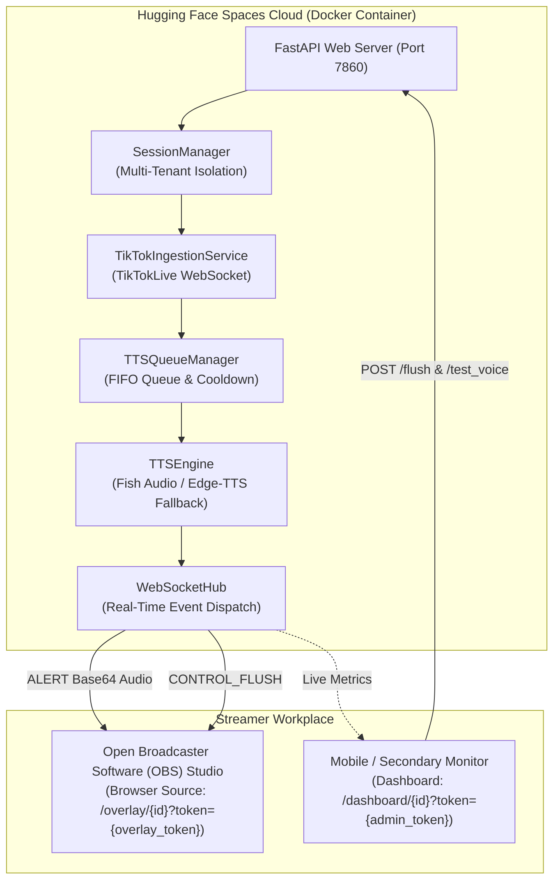

# 🎙️ TikTok Live Text-to-Speech (TTS) Bot & Cloud Web Platform

High-performance, zero-cost, and robust asynchronous Text-to-Speech (TTS) system and multi-tenant cloud platform for TikTok LIVE streamers. Converts incoming live chat comments and monetary gift events into real-time speech using Fish Audio Free Developer Tier with an automatic Microsoft Edge Neural Text-to-Speech (TTS) fallback, routed either through an Open Broadcaster Software (OBS) Studio transparent browser source with the Web Audio Application Programming Interface (Web Audio API) or locally through a Virtual Audio Cable (VAC).

---

## 📚 Streamer Documentation & Guides (คู่มือการใช้งาน)

| Document | Description | Format | Target Audience |
| :--- | :--- | :---: | :--- |
| ⚡ [**Quick Start Guide (เริ่มสตรีมใน 60 วินาที)**](docs/QUICK_START.md) | สรุปขั้นตอนด่วน 1 หน้าจบ สำหรับเริ่มสตรีมทันที ตั้งค่า OBS / TikTok Studio | Markdown | สตรีมเมอร์ที่ต้องการเริ่มใช้งานทันที |
| 📖 [**Official User Manual (คู่มือการใช้งานฉบับสมบูรณ์)**](docs/USER_MANUAL.md) | คู่มือภาษาไทยแบบละเอียด ตั้งค่า Browser Source, Advanced Audio, Dashboard & FAQ | Markdown | สตรีมเมอร์และผู้ดูแลระบบถ่ายทอดสด |

---

## 🌟 Key Architectural Features

- **Cloud & Desktop Dual-Mode Deployment:**
  - **Cloud Web Platform (Version 2.0):** Multi-tenant Asynchronous Server Gateway Interface (ASGI) server built with FastAPI, Uvicorn, and WebSocket (WS) streaming. Dockerized and deployable to Hugging Face Spaces with zero desktop driver setup required.
  - **Local Desktop Mode (Version 1.0):** Terminal Command-Line Interface (CLI) application routing speech through VB-Audio Virtual Cable (VAC) into Open Broadcaster Software (OBS) Studio with global Operating System (OS) keyboard hotkeys.
- **Asynchronous Event Ingestion:** Consumes live stream chat and gift events via WebSocket (WS) using the `TikTokLive` client library.
- **Thai Phonetic Normalization & Profanity Filtering:** Normalizes Thai chat slang (e.g., `555+` $\rightarrow$ `ฮ่าๆๆ`), suppresses emoji spam and character elongation, applies phonetic replacement mappings, and filters blacklisted words.
- **Priority First-In, First-Out (FIFO) Queue & Anti-Spam:** Fair comment scheduling with per-user cooldown timers, burst protection, and priority eviction for monetary gift announcements.
- **Dual-Engine Speech Synthesis (Zero-Cost):**
  - **Primary:** Fish Audio Free Developer Tier (`s2.1-pro-free` model) with local disk caching.
  - **Secondary:** Microsoft Edge Neural Text-to-Speech (`edge-tts` with `th-TH-NiwatNeural`) fallback upon network errors or Application Programming Interface (API) rate limits (`HTTP 429`).
- **Real-Time Web Audio Streaming & OBS Overlay:** Streams Base64-encoded audio chunks over WebSocket (WS) directly into Open Broadcaster Software (OBS) Studio browser sources, rendering transparent visual chat alerts and synthesized speech simultaneously.
- **Dual Token-Based Security Architecture:** Enforces cryptographic separation of privileges between read-only Open Broadcaster Software (OBS) overlay widgets and full streamer remote control dashboards.
- **Emergency Queue Purge & Mute:** Global emergency stop hotkey (`F9`) on desktop, or one-click `CONTROL_FLUSH` emergency mute button on the web control dashboard.

---

## ☁️ Cloud Web Platform & Hugging Face Spaces Deployment (Version 2.0)

The Cloud Web Platform eliminates the need to install Python, compilers, or virtual audio cables on the streamer's local computer.



### 1. Deploying to Hugging Face Spaces

1. Create a new Space on [Hugging Face Spaces](https://huggingface.co/spaces).
2. Configure Space settings:
   - **Space SDK:** `Docker`
   - **Docker Template:** `Blank`
   - **License:** `MIT`
3. Push this repository to the Hugging Face Spaces Git remote:
   ```bash
   git remote add space https://huggingface.co/spaces/YOUR_USERNAME/YOUR_SPACE_NAME
   git push space main
   ```
4. The provided `Dockerfile` will automatically compile and launch the application on `http://0.0.0.0:7860`.

### 2. Streamer Usage Instructions

> 💡 *สำหรับคู่มือภาษาไทยแบบละเอียดและคู่มือแบบ 60 วินาที โปรดอ่าน [Official User Manual](docs/USER_MANUAL.md) และ [Quick Start Guide](docs/QUICK_START.md)*

1. Open the deployed Hugging Face Spaces URL (or `http://localhost:7860` if running locally).
2. In the setup form:
   - Enter your target **TikTok Creator Username** (e.g. `@fb.jachamch`).
   - Enter your **Fish Audio API Key** (obtainable free from [Fish Audio](https://fish.audio)).
   - Customize cooldown timers, comment length limits, phonetic overrides, and word blacklists if desired.
   - Click **Start Live Session**.
3. In Open Broadcaster Software (OBS) Studio or TikTok LIVE Studio:
   - Add a new **Browser Source** (or **Link / Web Page** source in TikTok Studio) to your Scene.
   - Paste the generated **Overlay URL** (`/overlay/{session_id}?token={overlay_token}`).
   - Set Width to `600` and Height to `250` (or `1920`x`1080` if full-canvas placement is preferred).
   - Check **Control audio via OBS** (and enable *Monitor and Output* under Advanced Audio Properties so you can hear the bot).
4. On your mobile phone, tablet, or secondary monitor:
   - Open the generated **Streamer Dashboard URL** (`/dashboard/{session_id}?token={admin_token}`).
   - Use the **Test Voice** button to verify audio synthesis.
   - Use the **Emergency Mute** button (`CONTROL_FLUSH`) to instantly purge pending comments and silence active playback.

---

## 💻 Local Desktop Mode Setup Guide (Version 1.0)

### 1. System Prerequisites

1. **Operating System (OS):** Windows 10 / 11 (64-bit).
2. **Python Runtime:** Python 3.10, 3.11, or 3.12.
3. **VB-Audio Virtual Cable (VAC):** Free virtual audio driver ([Download from VB-Audio](https://vb-audio.com/Cable/)).
4. **Streaming Software:** Open Broadcaster Software (OBS) Studio ([OBS Project](https://obsproject.com/)).

### 2. Install VB-Audio Virtual Cable (VAC)

1. Download **VBCABLE_Driver_Pack43.zip** from [VB-Audio](https://vb-audio.com/Cable/).
2. Extract the archive and right-click `VBCABLE_Setup_x64.exe` $\rightarrow$ **Run as Administrator**.
3. Click **Install Driver** and reboot your computer when prompted.
4. Verify in Windows Sound Settings:
   - Output device available: `CABLE Input (VB-Audio Virtual Cable)`
   - Input device available: `CABLE Output (VB-Audio Virtual Cable)`

### 3. Configure Open Broadcaster Software (OBS) Studio for VAC

1. Open **Open Broadcaster Software (OBS) Studio**.
2. In the **Audio Mixer** dock, go to **File $\rightarrow$ Settings $\rightarrow$ Audio**.
3. Under **Global Audio Devices**, set **Mic/Auxiliary Audio 2** to:
   - `CABLE Output (VB-Audio Virtual Cable)`
4. In **Advanced Audio Properties**:
   - Set **Audio Monitoring** for the Cable source to `Monitor Off` (only stream viewers hear it) or `Monitor and Output` (if you also want to hear the bot in your headphones).

### 4. Clone Repository & Setup Virtual Environment

```powershell
# Navigate to the project directory
cd 05_Personal_Projects/01_AI_Agents/tiktok-live-tts-bot

# Create and activate Python virtual environment
python -m venv venv
.\venv\Scripts\Activate.ps1

# Install required dependencies
pip install -r requirements.txt
```

### 5. Configure Environment Variables

```powershell
copy .env.example .env
```

Edit `.env` with your preferred settings:

```ini
# TikTok Live Channel Configuration
TIKTOK_USERNAME=@your_channel_handle

# Fish Audio Application Programming Interface (API) Configuration
FISH_AUDIO_API_KEY=your_fish_audio_api_key_here
FISH_AUDIO_MODEL_ID=9c110ffde8bc42709516395dfbcfb4a2
FISH_AUDIO_TIER_MODEL=s2.1-pro-free

# Fallback Text-to-Speech (TTS) Configuration
ENABLE_FALLBACK_TTS=true
FALLBACK_VOICE=th-TH-NiwatNeural

# Audio Routing Configuration (Virtual Audio Cable: VAC)
AUDIO_OUTPUT_DEVICE_NAME=CABLE Input (VB-Audio Virtual Cable)

# Moderation & Playback Parameters (First-In, First-Out: FIFO Queue)
MAX_COMMENT_LENGTH=80
USER_COOLDOWN_SECONDS=15
MAX_QUEUE_SIZE=10
MIN_GIFT_COINS=1

# Operating System (OS) Global Emergency Stop Hotkey
EMERGENCY_HOTKEY=f9

# Audio Cache Directory
CACHE_DIR=.cache/audio
```

### 6. Launching Options

```powershell
# Option A: Run local terminal bot with Rich Live Dashboard & VAC routing
python main.py

# Option B: Run local FastAPI web server for browser overlay & remote dashboard
python main.py --web --port 7860
```

---

## 🧪 Testing

The automated test suite provides comprehensive test-driven development (TDD) coverage across all units, mocks, edge cases, WebSockets, HTML rendering, and end-to-end integration:

```powershell
# Run the complete test suite
pytest tests -v
```

---

## 📚 References & Standards

1. **Fish Audio Inc.** (2024). *Fish Speech: Open-Source Speech Synthesis Architecture*. Fish Audio Research. [https://fish.audio](https://fish.audio)
2. **Microsoft Corporation** (2024). *Microsoft Edge Neural Text-to-Speech (TTS) Voice Roster*. Microsoft Azure Cognitive Services.
3. **World Wide Web Consortium (W3C)** (2024). *Web Audio API Standard Specification*. W3C Audio Working Group. [https://www.w3.org/TR/webaudio/](https://www.w3.org/TR/webaudio/)
4. **Hugging Face Inc.** (2025). *Hugging Face Spaces Docker Specification and Container Application Architecture*. Hugging Face Documentation. [https://huggingface.co/docs/hub/spaces-sdks-docker](https://huggingface.co/docs/hub/spaces-sdks-docker)
5. **Bross, B., et al.** (2021). *Overview of the Versatile Video Coding (VVC) and Webcast Audio Pipeline Standards*. IEEE Transactions on Circuits and Systems for Video Technology, 31(10), 3736-3764. [https://doi.org/10.1109/TCSVT.2021.3056196](https://doi.org/10.1109/TCSVT.2021.3056196)
6. **VB-Audio Software** (2024). *VB-Audio Virtual Cable Specification and Inter-Process Audio Routing Architecture*. [https://vb-audio.com/Cable/](https://vb-audio.com/Cable/)
7. **PortAudio Community** (2024). *PortAudio Portable Real-Time Audio Library Architecture Reference*. [http://www.portaudio.com/](http://www.portaudio.com/)
