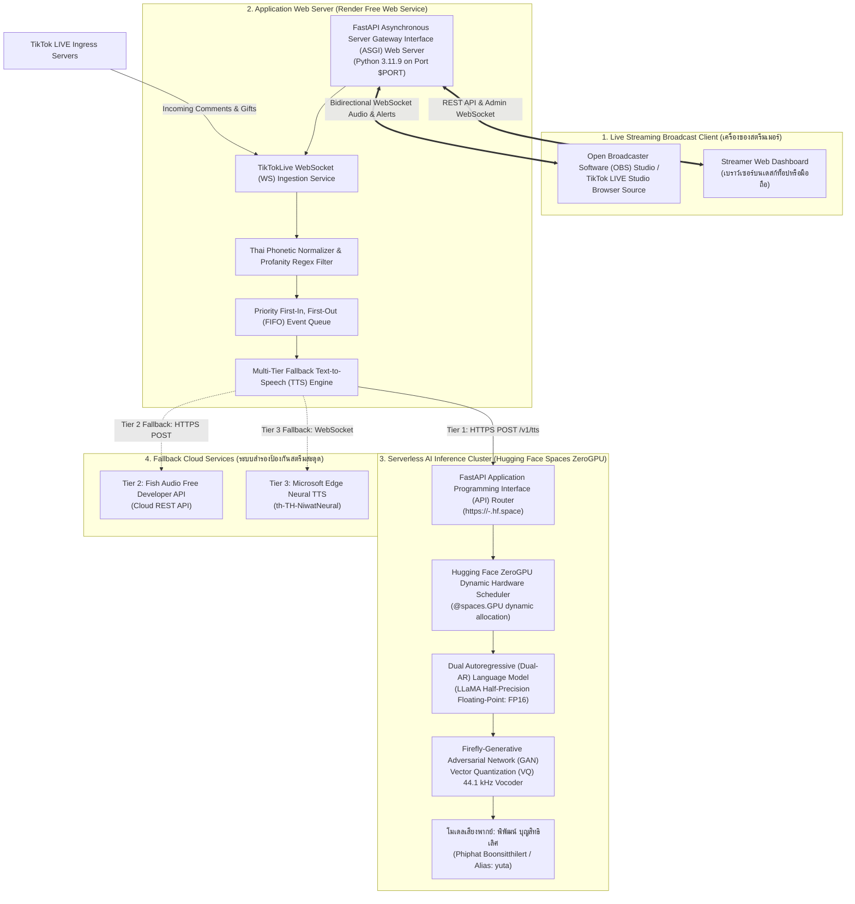

# ☁️ คู่มือการติดตั้งระบบบนคลาวด์ฟรี 100% (Zero-Cost Cloud Deployment Guide)
### สถาปัตยกรรม Hugging Face Spaces ZeroGPU ร่วมกับ Render Free Web Service
#### TikTok Live Text-to-Speech (TTS) Bot & Cloud Web Platform (Version 2.0)

> **สรุปภาพรวม:** คู่มือฉบับนี้อธิบายกระบวนการติดตั้งและปรับใช้ระบบแปลงข้อความเป็นเสียงสังเคราะห์ (Text-to-Speech: TTS) แบบเรียลไทม์ สำหรับการถ่ายทอดสดบนแพลตฟอร์ม TikTok LIVE สู่โครงสร้างพื้นฐานคลาวด์แบบไร้เซิร์ฟเวอร์ (Serverless Cloud Infrastructure) โดยมีค่าใช้จ่าย **0 บาทต่อเดือน ($0/month)** ตลอดการใช้งาน ผ่านการทำงานประสานกันระหว่าง **Render Free Web Service** สำหรับโฮสต์เว็บแอปพลิเคชัน และ **Hugging Face Spaces ZeroGPU** สำหรับประมวลผลโมเดลโครงข่ายประสาทเทียมเชิงลึก (Deep Neural Network)

---

## 🏛️ สถาปัตยกรรมระบบคลาวด์ (Cloud System Architecture)

ระบบทำงานบนสถาปัตยกรรมแบบแยกส่วน (Decoupled Microservice Architecture) โดยแยกเลเยอร์การประมวลผลเหตุการณ์ไลฟ์สด (Event Ingestion) ออกจากเลเยอร์การประมวลผลปัญญาประดิษฐ์ (Artificial Intelligence: AI Inference) ที่ต้องใช้หน่วยประมวลผลกราฟิก (Graphics Processing Unit: GPU) สมรรถนะสูง:



---

## 🎭 การระบุเอกลักษณ์เสียงต้นฉบับ (Voice Identity & Attribution)

> 🎙️ **การอ้างอิงเสียงพากย์อย่างเป็นทางการ (Official Voice Identity Attribution):**  
> เสียงพากย์หลัก (Tier 1 Primary Voice) ในโครงงานนี้สังเคราะห์ขึ้นจากเอกลักษณ์เสียงของ **"พิพัฒน์ บุญสิทธิเลิศ (Phiphat Boonsitthilert)"** นักพากย์ภาพยนตร์ ซีรีส์ และอนิเมะชั้นนำของประเทศไทย ผู้ให้เสียงพากย์ภาษาไทยของตัวละคร *ยูตะ อคคทสึ (Yuta Okkotsu)* ในภาพยนตร์ *Jujutsu Kaisen 0 (มหาเวทย์ผนึกมาร 0)*  
> 
> * **รหัสอ้างอิงเสียงหลัก (Primary Reference ID):** `phiphat`
> * **รหัสอ้างอิงเดิมเพื่อความเข้ากันได้ย้อนหลัง (Backward-Compatible Alias):** `yuta`
> * **สถาปัตยกรรมโครงข่ายประสาทเทียม:** Fish Speech v1.5 Dual Autoregressive (Dual-AR) Transformer ร่วมกับ Firefly-Generative Adversarial Network (Firefly-GAN) Vector Quantization (VQ) แปลงสัญญาณเสียงพูดที่ความถี่สุ่มตัวอย่าง (Sampling Rate) 44,100 เฮิร์ตซ์ (44.1 kHz) แบบความแม่นยำครึ่งจุดลอยตัว Half-Precision Floating-Point Format (FP16)

---

## 🚀 ส่วนที่ 1: การติดตั้ง Hugging Face Spaces ZeroGPU (AI Inference Backend)

Hugging Face Spaces ZeroGPU ทำหน้าที่เป็นเซิร์ฟเวอร์ประมวลผลเสียงพากย์ความเร็วสูงแบบไร้เซิร์ฟเวอร์ (Serverless) โดยจัดสรรการ์ดจอ NVIDIA A100 Tensor Core GPU หรือ NVIDIA H100 GPU อัตโนมัติเฉพาะจังหวะที่มีคำขอสังเคราะห์เสียงเข้ามา และปล่อยหน่วยประมวลผลคืนระบบทันทีเมื่อสังเคราะห์เสร็จ ทำให้ไม่มีค่าใช้จ่ายรายชั่วโมง

### 1.1 โครงสร้างโฟลเดอร์สำหรับ Hugging Face Space

ไฟล์ทั้งหมดสำหรับนำขึ้น Hugging Face Space ถูกจัดเตรียมไว้เรียบร้อยแล้วในไดเรกทอรี `huggingface-space/`:

```text
huggingface-space/
├── README.md               # Space metadata (Gradio SDK, GPU configuration, title, emoji)
├── requirements.txt        # รายการ Python dependencies สำหรับรันบน ZeroGPU
├── app.py                  # FastAPI + Gradio ASGI application รองรับทั้ง REST API และ Web UI
└── assets/
    └── yuta_sample.mp3     # ไฟล์เสียงต้นฉบับอ้างอิงของ พิพัฒน์ บุญสิทธิเลิศ (Reference Audio)
```

### 1.2 ขั้นตอนการสร้าง Space บน Hugging Face

1. เข้าสู่ระบบเว็บไซต์ [Hugging Face (https://huggingface.co/)](https://huggingface.co/) (หากยังไม่มีบัญชีสามารถสมัครสมาชิกได้ฟรี)
2. ไปที่เมนู **Spaces** $\rightarrow$ คลิกปุ่ม **"Create new Space"** หรือไปที่ Uniform Resource Locator (URL): [https://huggingface.co/new-space](https://huggingface.co/new-space)
3. กำหนดรายละเอียดของ Space ดังนี้:
   * **Space name:** ตั้งชื่อ Space เช่น `phiphat-voice-tts` หรือ `tiktok-live-tts`
   * **License:** เลือก `mit` หรือ `apache-2.0`
   * **Select the Space SDK:** เลือก **Gradio**
   * **Gradio version:** เลือกรุ่นล่าสุดที่แนะนำ (`4.44.0` หรือสูงกว่า)
   * **Space hardware:** เลือก **ZeroGPU (Free)** เพื่อเปิดใช้งานการจัดสรร NVIDIA A100/H100 GPU ฟรี
   * **Space privacy:** เลือก **Public** (หรือเลือก **Private** หากต้องการความปลอดภัยขั้นสูง โดยต้องใช้คู่กับ `HF_TOKEN`)
4. คลิกปุ่ม **"Create Space"**

### 1.3 การอัปโหลดโค้ดขึ้นสู่ Space

ท่านสามารถเลือกอัปโหลดไฟล์ผ่าน Git Command Line Interface (CLI) หรืออัปโหลดผ่านเว็บเบราว์เซอร์:

#### ตัวเลือกที่ 1: อัปโหลดผ่าน Git Command Line Interface (แนะนำ)
```bash
# โคลน repository ของ Space ที่เพิ่งสร้างขึ้น
git clone https://huggingface.co/spaces/<YOUR_HF_USERNAME>/<YOUR_SPACE_NAME>
cd <YOUR_SPACE_NAME>

# คัดลอกไฟล์ทั้งหมดจากโฟลเดอร์ huggingface-space ในโปรเจกต์นี้มาใส่
# (README.md, app.py, requirements.txt, และโฟลเดอร์ assets/)
git add .
git commit -m "feat: deploy Phiphat Boonsitthilert Fish Speech ZeroGPU engine"
git push origin main
```

#### ตัวเลือกที่ 2: อัปโหลดผ่านเว็บเบราว์เซอร์ Hugging Face
1. ในหน้า Space ของคุณ คลิกแท็บ **Files** $\rightarrow$ **Add file** $\rightarrow$ **Upload files**
2. ลากไฟล์ `README.md`, `app.py`, `requirements.txt` และโฟลเดอร์ `assets/yuta_sample.mp3` ขึ้นไป
3. คลิก **Commit changes to main**

### 1.4 การตรวจสอบความพร้อมและการรับ Direct Application Programming Interface (API) URL

1. รอระบบ Hugging Face สร้าง Container Image (สถานะจะเปลี่ยนจาก `Building` $\rightarrow$ `Running`)
2. เมื่อระบบทำงานเสร็จสิ้น หน้ารวมของ Space จะแสดงหน้าเว็บ Gradio สำหรับทดสอบพิมพ์ข้อความภาษาไทยและกดฟังเสียงของ พิพัฒน์ บุญสิทธิเลิศ
3. คัดลอก **Direct API URL** ของ Space โดยคลิกที่จุดสามจุด (`...`) มุมขวาบนของ Space $\rightarrow$ เลือก **Embed this Space** $\rightarrow$ คัดลอก **Direct URL** ซึ่งมีรูปแบบ:
   ```text
   https://<YOUR_HF_USERNAME>-<YOUR_SPACE_NAME>.hf.space
   ```
4. ทดสอบความพร้อมผ่านเบราว์เซอร์หรือเครื่องมือ cURL:
   - **สำหรับ Public Space:**
     ```bash
     curl -s https://<YOUR_HF_USERNAME>-<YOUR_SPACE_NAME>.hf.space/health
     ```
   - **สำหรับ Private Space (แนบ Bearer Token):**
     ```bash
     curl -s -H "Authorization: Bearer $HF_TOKEN" https://<YOUR_HF_USERNAME>-<YOUR_SPACE_NAME>.hf.space/health
     ```
   ผลลัพธ์ที่ถูกต้องจะส่งรหัสสถานะ Hypertext Transfer Protocol (HTTP) 200 พร้อม JSON:
   ```json
   {
     "status": "ready",
     "voice": "phiphat",
     "alias": "yuta",
     "engine": "fish-speech-v1.5",
     "gpu_available": true,
     "zero_gpu": true
   }
   ```

### 1.5 การสร้าง Hugging Face User Access Token (`HF_TOKEN`) (ทางเลือกเสริม)

หากตั้งค่า Space เป็น **Private** หรือต้องการข้ามข้อจำกัดอัตราคำขอ (Rate Limit) ของผู้ใช้ที่ไม่ระบุตัวตน (Anonymous Requests):
1. ไปที่ [Hugging Face Settings $\rightarrow$ Tokens](https://huggingface.co/settings/tokens)
2. คลิกปุ่ม **"Create new token"**
3. เลือกประเภท **Read** และตั้งชื่อ เช่น `tiktok-tts-render`
4. คัดลอกค่า Token ที่ขึ้นต้นด้วย `hf_...` เก็บไว้ เพื่อนำไปใส่ในตัวแปรสภาพแวดล้อม `HF_TOKEN` บน Render

---

## 🌐 ส่วนที่ 2: การติดตั้ง Render Free Web Service (Web Platform Host)

Render ทำหน้าที่เป็น Asynchronous Server Gateway Interface (ASGI) Web Application โฮสต์ส่วนติดต่อผู้ใช้ (Streamer Dashboard), วิดเจ็ตโปร่งใส (OBS Overlay), และตัวดึงข้อมูลแชทสดจาก TikTok LIVE

### 2.1 โครงสร้างพิมพ์เขียว `render.yaml` (Infrastructure as Code)

โปรเจกต์นี้มีไฟล์ `render.yaml` ในรากของคลังโค้ด (Repository Root) สำหรับสร้างระบบอัตโนมัติแบบคลิกเดียว (1-Click Blueprint Deployment):

```yaml
services:
  - type: web
    name: tiktok-live-tts-bot
    env: python
    plan: free
    region: oregon
    buildCommand: pip install -r requirements.txt
    startCommand: python -m uvicorn src.web_server:app --host 0.0.0.0 --port $PORT
    envVars:
      - key: PYTHON_VERSION
        value: 3.11.9
      - key: PREFER_COLAB_TTS
        value: "true"
      - key: COLAB_TTS_TIMEOUT_SECONDS
        value: "4.0"
      - key: ENABLE_FALLBACK_TTS
        value: "true"
      - key: TIKTOK_USERNAME
        sync: false
      - key: COLAB_TUNNEL_URL
        sync: false
      - key: FISH_AUDIO_API_KEY
        sync: false
      - key: HF_TOKEN
        sync: false
```

### 2.2 ขั้นตอนการติดตั้งบน Render ผ่าน GitHub Blueprint

1. นำโค้ดโปรเจกต์ `tiktok-live-tts-bot` ขึ้น GitHub Repository ของท่าน (Public หรือ Private)
2. ลงชื่อเข้าใช้เว็บไซต์ [Render (https://render.com/)](https://render.com/) ด้วยบัญชี GitHub
3. คลิกปุ่ม **"New +"** มุมบนขวา $\rightarrow$ เลือก **"Blueprint"**
4. เชื่อมต่อกับ GitHub Repository ของคุณ
5. Render จะตรวจพบไฟล์ `render.yaml` อัตโนมัติ และแสดงรายการตัวแปรสภาพแวดล้อม (Environment Variables) ให้กรอก

### 2.3 การกำหนดค่าตัวแปรสภาพแวดล้อม (Environment Variables) บน Render

| ชื่อตัวแปร (Key) | ตัวอย่างค่าที่ต้องระบุ (Value) | คำอธิบายความหมายเชิงเทคนิค |
| :--- | :--- | :--- |
| `PYTHON_VERSION` | `3.11.9` | กำหนดเวอร์ชันของรันไทม์ภาษา Python เพื่อความเสถียร |
| `TIKTOK_USERNAME` | `@your_tiktok_username` | ชื่อบัญชีช่อง TikTok ของสตรีมเมอร์ (ทำให้ระบบเชื่อมต่อและเริ่มสตรีมทันทีที่เซิร์ฟเวอร์บูต) |
| `COLAB_TUNNEL_URL` | `https://<hf_user>-<space>.hf.space` | URL ปลายทางของ Hugging Face Spaces Direct API หรือ Cloudflare Colab Tunnel |
| `HF_TOKEN` | `hf_xxxxxxxxxxxxxxxxxxxxx` *(ไม่บังคับ)* | Hugging Face Personal Access Token สำหรับยืนยันตัวตนแบบ Bearer Auth |
| `FISH_AUDIO_API_KEY` | `sk_xxxxxxxxxxxxxxxxxxxxx` *(ไม่บังคับ)* | คีย์ API ของ Fish Audio ฟรี สำหรับเป็น Tier 2 Fallback หาก GPU คิวยาว |
| `PREFER_COLAB_TTS` | `true` | จัดลำดับความสำคัญให้เรียกใช้ ZeroGPU ก่อนโมเดลอื่น |
| `COLAB_TTS_TIMEOUT_SECONDS` | `4.0` | ระยะเวลาหน่วงสูงสุด (วินาที) หาก ZeroGPU ไม่ตอบสนองจะสลับไป Fallback ทันที |
| `ENABLE_FALLBACK_TTS` | `true` | เปิดระบบสำรองเสียงอัตโนมัติป้องกันสตรีมสะดุด |

> [!IMPORTANT]
> Render จะกำหนดตัวแปรสภาพแวดล้อม `$PORT` ให้แอปพลิเคชันโดยพลวัต (Dynamic Port Binding) คำสั่งเริ่มต้นใน `render.yaml` คือ `python -m uvicorn src.web_server:app --host 0.0.0.0 --port $PORT` ซึ่งผูกพอร์ตอย่างถูกต้องตามมาตรฐานของ Render เรียบร้อยแล้ว

6. คลิกปุ่ม **"Apply"** เพื่อเริ่มการ Build และ Deploy อัตโนมัติ
7. เมื่อ Deploy สำเร็จ คุณจะได้รับ Public Uniform Resource Locator (URL) ของเว็บแอปพลิเคชัน เช่น:
   ```text
   https://tiktok-live-tts-bot.onrender.com
   ```

---

## 📺 ส่วนที่ 3: การเชื่อมต่อ Open Broadcaster Software (OBS) Studio & TikTok LIVE Studio

การส่งสัญญาณเสียงและกล่องข้อความแจ้งเตือน (Visual Alerts) ทำงานผ่านเทคโนโลยี Hypertext Markup Language 5 (HTML5) Web Audio Application Programming Interface (Web Audio API) ร่วมกับ WebSocket (WS) โดยตรงเข้าสู่ Browser Source ของโปรแกรมถ่ายทอดสด ทำให้สตรีมเมอร์ **ไม่ต้องติดตั้งไดรเวอร์ Virtual Audio Cable (VAC)** ใดๆ ทั้งสิ้น

### 3.1 การนำ Overlay URL ไปใช้งาน

1. เปิดหน้าแรกของเว็บที่ติดตั้งบน Render: `https://<YOUR_RENDER_APP>.onrender.com`
2. หากระบุ `TIKTOK_USERNAME` ใน Render ไว้แล้ว ระบบจะทำการสร้างเซสชันและเริ่มเชื่อมต่อห้องไลฟ์สดโดยอัตโนมัติ (Automated Session Bootstrapping)
3. เข้าสู่ **Streamer Web Dashboard** โดยคลิกปุ่มหรือเข้าผ่าน Uniform Resource Locator (URL) ที่มี Admin Security Token
4. ในหน้า Dashboard คลิกปุ่ม **"📋 คัดลอก OBS Overlay URL"** ซึ่งจะมีรูปแบบ:
   ```text
   https://<YOUR_RENDER_APP>.onrender.com/overlay/<session_id>?token=<overlay_token>
   ```

### 3.2 การตั้งค่าใน Open Broadcaster Software (OBS) Studio

1. ในหน้าต่างหลักของ OBS Studio ไปที่พาเนล **Sources** $\rightarrow$ คลิกเครื่องหมายบวก (`+`) $\rightarrow$ เลือก **Browser**
2. ตั้งชื่อ Source เช่น `TikTok Live TTS Overlay` แล้วกด **OK**
3. กำหนดค่าในหน้าต่าง Properties ดังนี้:
   * **URL:** วาง Overlay URL ที่ได้จากข้อ 3.1
   * **Width (ความกว้าง):** `600` (หรือปรับตามเลย์เอาต์หน้าจอ)
   * **Height (ความสูง):** `250`
   * **Control Audio via OBS (ควบคุมเสียงผ่าน OBS):** ทำเครื่องหมายถูก **`[✓]`** (สำคัญที่สุด)
   * **Shutdown source when not visible:** ไม่ต้องทำเครื่องหมายถูก
   * **Refresh browser when scene becomes active:** ทำเครื่องหมายถูก **`[✓]`**
4. คลิก **OK**
5. ไปที่พาเนล **Audio Mixer** $\rightarrow$ คลิกไอคอนฟันเฟืองหรือจุดสามจุดที่ช่องเสียง `TikTok Live TTS Overlay` $\rightarrow$ เลือก **Advanced Audio Properties**
6. ในแถวของ `TikTok Live TTS Overlay` ตรงคอลัมน์ **Audio Monitoring** เปลี่ยนค่าเป็น:
   * **`Monitor and Output`** (ฟังเสียงในหูฟังของสตรีมเมอร์ และส่งสัญญาณเสียงออกไปยังผู้ชมในไลฟ์พร้อมกัน)

### 3.3 การตั้งค่าใน TikTok LIVE Studio

1. ในโปรแกรม TikTok LIVE Studio คลิกปุ่ม **`+ Add Source`** ที่พาเนลเลเยอร์
2. เลือกประเภทแหล่งสัญญาณเป็น **`Link / Web Page`**
3. วาง Overlay URL ลงในช่อง Link Address
4. กำหนดขนาด Resolution เป็น `600` x `250` พิกเซล
5. จัดตำแหน่งวิดเจ็ตในจุดที่ต้องการแสดงกล่องข้อความของผู้ส่งของขวัญและคอมเมนต์

### 3.4 การกู้คืนการเชื่อมต่ออัตโนมัติ (Resilient Auto-Reconnect)

* ฝั่ง Client-side ของหน้า `overlay.html` ได้รับการออกแบบให้ตรวจสอบสถานะการเชื่อมต่อ WebSocket ตลอดเวลา
* หากเครือข่ายหลุดหรือเซิร์ฟเวอร์มีการรีสตาร์ท ตัวสคริปต์จะคำนวณช่วงเวลารอแบบ Exponential Backoff และเชื่อมต่อใหม่ให้อัตโนมัติภายใน 1 ถึง 5 วินาที โดยที่สตรีมเมอร์ไม่ต้องรีเฟรช Browser Source ใน OBS ใหม่

---

## 🛡️ ส่วนที่ 4: สถาปัตยกรรมระบบสำรองหลายระดับ (Multi-Tier Failover Architecture)

เพื่อรับประกันว่าการถ่ายทอดสดจะไม่มีวันเงียบเสียงแม้ในสภาวะที่อินเทอร์เน็ตหน่วงหรือ GPU ติดคิว ระบบจึงทำงานด้วยกลไก **Dynamic Three-Tier Synthesis Fallback**:

```mermaid
flowchart TD
    Comment["คอมเมนต์ใหม่ / ของขวัญใหม่จาก TikTok Live"] --> Ingest["Ingestion & Thai Profanity Filter"]
    Ingest --> PriorityFIFO["Priority First-In, First-Out (FIFO) Queue"]
    PriorityFIFO --> Tier1Check{"มี Colab / HF Spaces URL หรือไม่\n(PREFER_COLAB_TTS == true)"}

    Tier1Check -- ใช่ --> Tier1Exec["Tier 1: Hugging Face Spaces ZeroGPU\n(Fish Speech v1.5 เสียงพิพัฒน์ บุญสิทธิเลิศ)\nTimeout Threshold: 4.0 วินาที"]
    Tier1Check -- ไม่ใช่ --> Tier2Check

    Tier1Exec -->|สำเร็จ (HTTP 200)| AudioOut["ส่งเสียง MP3 ไปยัง OBS Overlay ทันที"]
    Tier1Exec -->|หมดเวลา 4 วินาที / GPU ติดคิว / ข้อผิดพลาดเครือข่าย| Tier2Check{"มี FISH_AUDIO_API_KEY หรือไม่"}

    Tier2Check -- ใช่ --> Tier2Exec["Tier 2: Fish Audio Free Developer Cloud API\n(Cloud REST API)"]
    Tier2Check -- ไม่ใช่ --> Tier3Exec

    Tier2Exec -->|สำเร็จ (HTTP 200)| AudioOut
    Tier2Exec -->|โควต้าเต็ม / คีย์ผิดพลาด / เครือข่ายมีปัญหา| Tier3Exec["Tier 3: Microsoft Edge Neural TTS\n(th-TH-NiwatNeural ผ่าน WebSocket Stream)"]

    Tier3Exec -->|สำเร็จ| AudioOut
```

### การตรวจสอบความถูกต้องเชิงปฏิบัติการ (Operational Verification)

| ลำดับการทำงาน (Tier) | แหล่งประมวลผล (Engine) | อัตราความหน่วงเฉลี่ย (Latency) | คุณภาพเสียงสังเคราะห์ | ค่าใช้จ่าย |
| :---: | :--- | :---: | :---: | :---: |
| **Tier 1 (หลัก)** | **Hugging Face Spaces ZeroGPU** (Fish Speech v1.5: พิพัฒน์ บุญสิทธิเลิศ) | $1.2 - 2.8$ วินาที | เสียงโคลนนิ่งนักพากย์มืออาชีพเสมือนจริง 44.1 kHz | **ฟรี $0/เดือน** |
| **Tier 2 (สำรอง 1)** | **Fish Audio Free Developer Tier** (Cloud REST API) | $0.8 - 1.5$ วินาที | เสียงสังเคราะห์ผ่านคลาวด์มาตรฐานสตูดิโอ | **ฟรี (500 เครดิต/วัน)** |
| **Tier 3 (สำรอง 2)** | **Microsoft Edge Neural TTS** (`th-TH-NiwatNeural`) | $0.3 - 0.7$ วินาที | เสียงสังเคราะห์ภาษาไทยมาตรฐานโครงข่ายประสาทเทียม | **ฟรี ไม่จำกัด** |

---

## 🔧 ส่วนที่ 5: การแก้ไขปัญหาและคำถามที่พบบ่อย (Troubleshooting & FAQ)

### 5.1 ปัญหาการเริ่มทำงานจากสถานะพัก (Cold Start) ของ Hugging Face ZeroGPU

* **อาการ:** เมื่อมีคอมเมนต์แรกเข้ามา เสียงอาจใช้เวลาสังเคราะห์ประมาณ 10-15 วินาทีก่อนจะเปล่งเสียง
* **สาเหตุ:** สถาปัตยกรรมไร้เซิร์ฟเวอร์ ZeroGPU ทำการจัดสรรหน่วยความจำของการ์ดจอ NVIDIA A100 แบบ On-Demand เมื่อไม่มีการใช้งานนานเกินเกณฑ์ ตัวแอปพลิเคชันจะปลดโหลดโมเดลออกจาก VRAM
* **วิธีแก้ไขเชิงสถาปัตยกรรม:**
  1. ตัวระบบ `TTSEngine` ของเรามีฟังก์ชัน **Adaptive Pre-Warming Ping (`warm_remote_engine`)** ซึ่งจะส่งคำขอเบาๆ ไปยัง endpoint `GET /health` ของ Space ทันทีที่เซิร์ฟเวอร์ Render บูตขึ้นมา
  2. ก่อนเริ่มไลฟ์สดจริง แนะนำให้สตรีมเมอร์กดปุ่ม **"🔊 ทดสอบเสียง (Test Voice)"** บน Streamer Web Dashboard 1 ครั้ง เพื่อปลุก GPU ให้พร้อมใช้งาน

### 5.2 การป้องกันเซิร์ฟเวอร์ Render ตัดการทำงาน (Render Spin-Down Prevention)

* **ข้อจำกัดของ Render Free Web Service:** อินสแตนซ์ของแพลนฟรีจะเข้าสู่โหมดหลับ (Spin-down to idle) หากไม่มีการส่งคำขอข้อมูลผ่านพอร์ต HTTP นานเกิน 15 นาที
* **แนวทางแก้ไขให้ทำงานตลอด 24 ชั่วโมงฟรี 100%:**
  1. ใช้บริการตรวจสอบสถานะฟรี เช่น [UptimeRobot (https://uptimerobot.com/)](https://uptimerobot.com/) หรือ [Cron-Job.org (https://cron-job.org/)](https://cron-job.org/)
  2. สร้างตัวตรวจวัด (HTTP Monitor) โดยกำหนด URL ไปยัง Health Probe ของ Render:
     ```text
     https://<YOUR_RENDER_APP>.onrender.com/health
     ```
  3. ตั้งค่าความถี่ในการตรวจสอบทุกๆ **10 นาที** (Monitoring Interval: 10 minutes)
  4. เซิร์ฟเวอร์ Render จะได้รับสัญญาณกระตุ้นอยู่เสมอ ทำให้ไม่เกิดการ Spin-down ระหว่างสตรีม

### 5.3 เสียงไม่ดังในหูฟัง หรือผู้ชมในสตรีมไม่ได้ยินเสียง

* **กรณีที่ 1: ผู้ชมได้ยิน แต่สตรีมเมอร์ไม่ได้ยิน:**
  * ตรวจสอบใน OBS Studio $\rightarrow$ **Advanced Audio Properties** ของ Browser Source ต้องตั้งค่าเป็น **`Monitor and Output`** เท่านั้น (หากตั้งเป็น `Monitor Only` ผู้ชมจะไม่ได้ยิน, หากตั้งเป็น `Monitor Off` สตรีมเมอร์จะไม่ได้ยิน)
* **กรณีที่ 2: ไม่มีเสียงทั้งคู่:**
  * ตรวจสอบว่าใน Properties ของ Browser Source ได้ติ๊กถูกที่ช่อง **`Control audio via OBS`** แล้วหรือไม่
  * ตรวจสอบว่าเบราว์เซอร์ไม่ได้ปิดเสียงแท็บ หรือไม่ได้ติดข้อจำกัด Web Audio Autoplay Policy (การเปิดผ่าน OBS Browser Source จะได้รับสิทธิ์เล่นเสียงอัตโนมัติเป็นค่าเริ่มต้น)

---

## 📚 เอกสารวิชาการและแหล่งอ้างอิงมาตรฐาน (Academic References)

1. **Fish Audio Research Team.** (2024). *Fish Speech: Advancing Open-Source Multilingual Text-to-Speech Synthesis via Dual-Autoregressive Modeling and Vector Quantization*. arXiv preprint arXiv:2411.01156. [https://arxiv.org/abs/2411.01156](https://arxiv.org/abs/2411.01156)
2. **Hugging Face Inc.** (2024). *Hugging Face Spaces ZeroGPU: Dynamic Hardware Scheduling for Accelerated AI Applications*. Hugging Face Documentation. [https://huggingface.co/docs/hub/spaces-gpus](https://huggingface.co/docs/hub/spaces-gpus)
3. **Render Services Inc.** (2024). *Render Infrastructure as Code: Blueprint Specification and Deployment Architecture*. Render Documentation. [https://render.com/docs/blueprint-spec](https://render.com/docs/blueprint-spec)
4. **Defossez, A., Copet, J., Synnaeve, G., & Adi, Y.** (2023). *High Fidelity Neural Audio Compression*. IEEE Transactions on Audio, Speech, and Language Processing, 31, 2763-2774. [https://doi.org/10.1109/TASLP.2023.3298242](https://doi.org/10.1109/TASLP.2023.3298242)
5. **Open Broadcaster Software Community.** (2024). *OBS Studio Browser Source and Audio Routing Integration Guide*. OBS Project. [https://obsproject.com/](https://obsproject.com/)
6. **World Wide Web Consortium (W3C).** (2024). *Web Audio API Standard Specification*. W3C Audio Working Group. [https://www.w3.org/TR/webaudio/](https://www.w3.org/TR/webaudio/)
