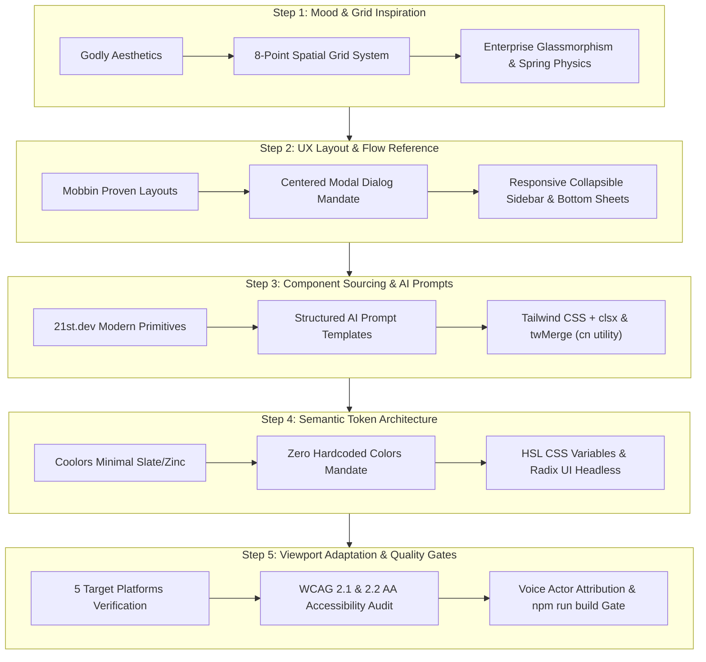

# คู่มือกระบวนการปฏิบัติงานมาตรฐานการพัฒนาส่วนติดต่อผู้ใช้งานด้วยปัญญาประดิษฐ์
## Standard Operating Procedure for AI-Assisted UI/UX Engineering (SOP-AI-UI-2026-V1)

**โครงการวิจัยและพัฒนาระบบสตรีมมิ่งและแดชบอร์ดสังเคราะห์เสียงอัจฉริยะ (Capstone Project 1321205)**  
**สาขาวิชาวิศวกรรมคอมพิวเตอร์และปัญญาประดิษฐ์ (Computer Engineering and Artificial Intelligence)**  
**สถาบันการจัดการปัญญาภิวัฒน์ (Panyapiwat Institute of Management: PIM)**  

---

### ข้อมูลเอกสารและสิทธิ์ความเป็นเจ้าของ (Document Metadata & Attribution)

- **รหัสเอกสาร:** SOP-AI-UI-2026-V1
- **ชื่อเอกสาร:** คู่มือกระบวนการปฏิบัติงานมาตรฐานการพัฒนาส่วนติดต่อผู้ใช้งานด้วยปัญญาประดิษฐ์ (Standard Operating Procedure for AI-Assisted UI/UX Engineering)
- **วันที่ประกาศใช้:** 8 พฤศจิกายน 2026
- **สถานะ:** ข้อบังคับมาตรฐานวิศวกรรมซอฟต์แวร์ (Mandatory Engineering Standard)
- **นักพากย์ต้นแบบหลักผู้ถือลิขสิทธิ์เสียง (Master Voice Actor):** **คุณพิพัฒน์ บุญสิทธิเลิศ (Phiphat Boonsitthilert)**

---

## 1. บทนำและขอบเขตการบังคับใช้ (Introduction & Operational Scope)

การพัฒนาส่วนติดต่อผู้ใช้งาน (User Interface: UI) และประสบการณ์ผู้ใช้ (User Experience: UX) ในยุคปัจจุบันจำเป็นต้องอาศัยการทำงานร่วมกันระหว่างวิศวกรซอฟต์แวร์ (Software Engineers) และตัวแทนปัญญาประดิษฐ์ (Artificial Intelligence Agents: AI Agents) บนพื้นฐานของโมเดลภาษาขนาดใหญ่ (Large Language Model: LLM) โดยยึดหลักการพัฒนาที่ขับเคลื่อนด้วยคอมโพเนนต์ (Component-Driven Development: CDD)

เพื่อป้องกันปัญหาความไม่สอดคล้องกันของโค้ด (Code Inconsistency), การเกิดหนี้ทางเทคนิค (Technical Debt), ความล้มเหลวด้านการเข้าถึง (Accessibility Failures), หรือข้อผิดพลาดในการแสดงผลข้ามอุปกรณ์ คู่มือกระบวนการปฏิบัติงานมาตรฐาน (Standard Operating Procedure: SOP) ฉบับนี้จึงถูกกำหนดขึ้นเพื่อเป็นแบบแผนปฏิบัติ 5 ขั้นตอน (5-Step SOP Workflow) ที่ทั้งวิศวกรและ AI ต้องปฏิบัติตามอย่างเคร่งครัด 100% ทุกครั้งที่มีการออกแบบ สร้าง หรือปรับแต่งคอมโพเนนต์ในแอปพลิเคชันหน้าเดียว (Single-Page Application: SPA)

นอกจากนี้ ทุกคอมโพเนนต์ที่เกี่ยวข้องกับระบบควบคุมเสียง การสังเคราะห์เสียงพูดจากข้อความ (Text-to-Speech: TTS) และการจำลองสัญญาณเสียง ต้องรักษาอัตลักษณ์และแสดงป้ายกำกับให้เกียรติแก่ **คุณพิพัฒน์ บุญสิทธิเลิศ (Phiphat Boonsitthilert)** ในฐานะนักพากย์ต้นแบบหลักของระบบเสมอ

---

## 2. แผนผังสถาปัตยกรรมกระบวนการ 5 ขั้นตอน (5-Step SOP Workflow Architecture)

กระบวนการสร้างและปรับแต่ง UI/UX ประกอบด้วย 5 ขั้นตอนเชิงระบบที่ส่งต่อผลลัพธ์ซึ่งกันและกันอย่างเป็นลำดับขั้น:



---

## 3. รายละเอียดขั้นตอนการดำเนินงานมาตรฐาน (Detailed SOP Procedures)

### ขั้นตอนที่ 1: การกำหนดสุนทรียภาพและระบบโครงสร้างเชิงพื้นที่ (Step 1: Mood & Grid Inspiration - Godly)

วิศวกรและ AI ต้องเริ่มต้นด้วยการวิเคราะห์สุนทรียภาพ จังหวะการมองเห็น และการเคลื่อนไหว โดยอิงหลักการของ Godly:

1. **ระบบโครงสร้างกริดเชิงพื้นที่ 8 จุด (8-Point Spatial Grid System):**
   - ระยะห่างภายนอก (Margin), ระยะห่างภายใน (Padding), ช่องว่างระหว่างองค์ประกอบ (Gap), และความสูงของคอมโพเนนต์ ต้องเป็นพหุคูณของ `4px` หรือ `8px` เสมอ
   - ค่ามาตรฐานใน Tailwind CSS:
     - ช่องว่างขนาดเล็กมาก (Micro Spacing): `p-1` (4px), `p-2` (8px), `gap-2` (8px)
     - ช่องว่างมาตรฐานคอมโพเนนต์ (Component Spacing): `p-4` (16px), `p-6` (24px), `gap-4` (16px), `gap-6` (24px)
     - ช่องว่างระดับโครงสร้างหน้า (Page Layout Spacing): `py-8` (32px), `py-12` (48px), `py-16` (64px)
   - ห้ามใช้ตัวเลขอิสระตามใจชอบ เช่น `p-[13px]`, `gap-[7px]` โดยไม่มีเหตุผลทางกายภาพรองรับ

2. **เทคนิคกลาสมอร์ฟิซึมระดับองค์กร (Enterprise Glassmorphism):**
   - หน้าต่างลอย เมนูแถบเครื่องมือ และแผงควบคุมต้องใช้พื้นหลังแบบกึ่งโปร่งแสงที่มีการเบลออย่างประณีต:
     ```tsx
     // ตัวอย่างการใช้ Glassmorphism ตามมาตรฐาน
     className="bg-card/80 backdrop-blur-md border border-border/50 shadow-md"
     ```
   - ขอบเส้นต้องใช้ความโปร่งแสงต่ำ (`border-border/50` หรือ `border-white/10`) เพื่อเพิ่มมิติความลึก (Visual Depth) โดยไม่บดบังความชัดเจนของข้อความ

3. **ฟิสิกส์การตอบสนองระดับไมโคร (Micro-Interactions & Spring Physics):**
   - การเปลี่ยนแปลงสถานะ (Hover, Active, Focus, Toggle) ต้องนุ่มนวลและตอบสนองทันที:
     - ระยะเวลาการเปลี่ยนผ่าน (Transition Duration): `150ms` ถึง `200ms` (Tailwind: `duration-200`)
     - ฟังก์ชันความเร่ง (Easing Curve): `cubic-bezier(0.16, 1, 0.3, 1)` (Ease-out Quint)
     - การกดปุ่มสัมผัส (Active Depression): `active:scale-[0.98]` หรือ `active:scale-[0.97]` บนปุ่มหลัก

4. **ลำดับชั้นตัวอักษรระดับสากล (Typography Hierarchy):**
   - ใช้ Geist หรือ Inter สำหรับตัวเลข ตัวอักษรภาษาอังกฤษ และรหัสเทคนิค
   - ใช้ Prompt สำหรับเนื้อหาและป้ายกำกับภาษาไทย
   - สำหรับหัวข้อหลัก (Headings): บังคับใช้ `tracking-tight font-bold text-foreground` เพื่อสร้างความหนักแน่นและเป็นทางการ

---

### ขั้นตอนที่ 2: การออกแบบโครงสร้างและการจัดวางเลย์เอาต์ (Step 2: UX Layout & Flow Reference - Mobbin)

อ้างอิงแบบแผนส่วนต่อประสานที่ผ่านการพิสูจน์แล้วในอุตสาหกรรมจาก Mobbin เพื่อขจัดข้อผิดพลาดเชิงโครงสร้าง:

1. **กฎการจัดกึ่งกลางหน้าต่างแบบผุดสมบูรณ์แบบ 100% (Centered Modal Dialog Mandate):**
   - หน้าต่างไดอะล็อก (Modal Dialog), กล่องยืนยันการกระทำ (Confirmation Alert), หรือป็อปอัปทุกตัว **ต้องถูกตรึงไว้ที่จุดกึ่งกลางหน้าจอเสมอ**
   - ห้ามใช้การคำนวณ Absolute Offset แบบลอยตัว ให้ใช้โครงสร้าง CSS Grid Centering ร่วมกับ Overlay:
     ```tsx
     <div className="fixed inset-0 z-50 grid place-items-center p-4 overflow-y-auto">
       {/* Backdrop Overlay */}
       <div 
         className="fixed inset-0 bg-black/60 backdrop-blur-sm transition-opacity" 
         onClick={handleClose} 
       />
       
       {/* Centered Modal Container */}
       <div 
         role="dialog" 
         aria-modal="true" 
         className="relative z-50 w-full max-w-lg bg-card text-card-foreground rounded-lg border border-border shadow-lg p-6 max-h-[90dvh] overflow-y-auto"
       >
         {/* Dialog Content */}
       </div>
     </div>
     ```
   - **การป้องกันเนื้อหาหลุดขอบ:** กำหนด `max-h-[90dvh]` ควบคู่กับ `overflow-y-auto` เพื่อให้ผู้ใช้สมาร์ตโฟนสามารถเลื่อนดูเนื้อหาภายในไดอะล็อกได้แม้แป้นพิมพ์เสมือนจะปรากฏขึ้น

2. **แถบนำทางด้านข้างแบบปรับเปลี่ยนตามขนาดหน้าจอ (Responsive Collapsible Sidebar):**
   - **หน้าจอ Desktop (>= 1024px):** แสดง Persistent Sidebar ขนาด `w-64` หรือ `w-72` พร้อมปุ่มกดเพื่อย่อเป็น Mini Icon Sidebar (`w-16`)
   - **หน้าจอ Mobile (< 1024px):** ซ่อน Sidebar จากการไหลปกติของเอกสาร และเปลี่ยนเป็น Off-canvas Drawer (Sheet) ที่เลื่อนมาจากขอบซ้ายเมื่อกดปุ่ม Hamburger Icon

3. **แผ่นเลื่อนจากขอบล่างสำหรับอุปกรณ์พกพา (Mobile Bottom Sheets):**
   - ตัวเลือกการตั้งค่าด่วน การเลือกเสียงพากย์ หรือตัวกรองข้อมูลบน Mobile Viewport ต้องแสดงผลในรูปแบบ Bottom Sheet เลื่อนจากล่างขึ้นบน เพื่อให้อยู่ในระยะการเอื้อมของนิ้วหัวแม่มือ (Thumb-Friendly Ergonomics)

4. **เมทริกซ์ความน่าเชื่อถือ 3 สถานะ (The 3-State Reliability Matrix):**
   - ทุกคอมโพเนนต์ที่ดึงข้อมูลแบบ Asynchronous ต้องมีครบทั้ง 3 สถานะ:
     - **Loading State:** แสดง Skeleton Placeholder ตามสัดส่วนจริง ห้ามใช้ตัวหมุน Spinner ลอยๆ เพียงอย่างเดียว
     - **Error State:** แสดงกล่องข้อความเตือนสีกึ่งโปร่งแสง `bg-destructive/10 text-destructive border-destructive/20` พร้อมปุ่ม "ลองใหม่อีกครั้ง (Retry)"
     - **Empty State:** แสดงภาพกราฟิกหรือไอคอนสี `text-muted-foreground` พร้อมข้อความแจ้งเตือนที่ชัดเจนและปุ่มดำเนินการหลัก (Call-to-Action: CTA)

---

### ขั้นตอนที่ 3: การจัดหาคอมโพเนนต์และวิศวกรรมคำสั่ง AI (Step 3: Component Sourcing & Prompts - 21st.dev)

เมื่อต้องสร้างคอมโพเนนต์ใหม่ วิศวกรต้องส่งคำสั่ง Prompt ให้แก่ AI โดยใช้โครงสร้างแบบมีระเบียบ (Structured Prompt Engineering):

#### 3.1 แม่แบบคำสั่งสำหรับ AI (AI System & Component Prompt Template)

```markdown
คุณคือ Senior Frontend Architect และ AI Engineer สำหรับโปรเจกต์ Capstone (1321205)
กรุณาสร้างคอมโพเนนต์ [ใส่ชื่อคอมโพเนนต์ เช่น VoiceSettingsDialog] ตามมาตรฐานอย่างเคร่งครัด:

1. สถาปัตยกรรมและเทคโนโลยี:
   - React 19 + TypeScript (Strict Mode) Functional Component
   - Tailwind CSS Utility Classes เท่านั้น
   - ใช้ฟังก์ชันยูทิลิตี cn() จาก `@/lib/utils` สำหรับรวมคลาสและจัดการ Class Variance
   - รองรับ Polymorphic Slot Pattern (`asChild`) ผ่าน Radix UI หรือ Pure React

2. ข้อกำหนดการใช้ Semantic Design Tokens:
   - ห้ามใช้รหัสสีคงที่ (Hex Code เช่น #ffffff) หรือสีคงที่ของ Tailwind (เช่น bg-blue-600, text-zinc-900)
   - ต้องใช้ตัวแปร Semantic HSL Tokens เท่านั้น:
     - พื้นหลัง: `bg-background`, `bg-card`, `bg-popover`, `bg-muted`
     - ข้อความ: `text-foreground`, `text-card-foreground`, `text-muted-foreground`
     - แอ็กชัน: `bg-primary`, `text-primary-foreground`, `bg-secondary`
     - สถานะอันตราย: `bg-destructive`, `text-destructive-foreground`
     - สถานะถ่ายทอดสด: `bg-broadcast-red`, `hover:bg-broadcast-red-hover`

3. ข้อกำหนดโครงสร้างและ Ergonomics:
   - หากเป็น Modal Dialog ต้องจัดกึ่งกลาง 100% ด้วย `fixed inset-0 grid place-items-center p-4`
   - ขนาดสัมผัสขั้นต่ำบน Mobile (Touch Target): `min-h-[44px]` และ `min-w-[44px]`
   - มี Accessible Focus Ring: `focus-visible:ring-2 focus-visible:ring-ring focus-visible:ring-offset-2`
   - ใส่ ARIA Attributes ครบถ้วน (aria-label, aria-modal, role, aria-expanded)

4. การให้เกียรตินักพากย์หลัก (Voice Actor Attribution):
   - หากมีส่วนเลือกเสียงพากย์หลัก ต้องแสดง Badge: `เสียงพากย์หลัก: คุณพิพัฒน์ บุญสิทธิเลิศ`
```

#### 3.2 การใช้งานฟังก์ชันยูทิลิตี `cn()` อย่างถูกต้อง

คอมโพเนนต์ทุกชิ้นต้องนำเข้าและรวมคลาสผ่าน `cn()` จาก `@/lib/utils` เพื่อป้องกันการชนกันของคลาส Tailwind:

```tsx
import * as React from "react"
import { cn } from "@/lib/utils"

export interface ComponentProps extends React.HTMLAttributes<HTMLDivElement> {
  variant?: "default" | "active"
}

export const ModernCard = React.forwardRef<HTMLDivElement, ComponentProps>(
  ({ className, variant = "default", children, ...props }, ref) => {
    return (
      <div
        ref={ref}
        className={cn(
          "rounded-lg border border-border bg-card p-6 text-card-foreground shadow-sm transition-colors",
          variant === "active" && "border-primary ring-1 ring-primary",
          className
        )}
        {...props}
      >
        {children}
      </div>
    )
  }
)
ModernCard.displayName = "ModernCard"
```

---

### ขั้นตอนที่ 4: สถาปัตยกรรมโทเค็นเชิงความหมาย (Step 4: Semantic Token Architecture - Coolors + shadcn/ui)

ระบบใช้สถาปัตยกรรมชุดสีแบบ Clean Minimal Enterprise (Slate/Zinc) โดยมีกฎเหล็กที่ต้องปฏิบัติ:

1. **กฎเหล็กห้ามใช้สีคงที่ (Zero Hardcoded Colors Mandate):**
   - **สิ่งที่ต้องห้ามเด็ดขาด (Violations):**
     - รหัสสี Hex/RGB: `#ffffff`, `#000000`, `#3b82f6`, `#ef4444`, `rgb(15, 23, 42)`
     - คลาสสีตายตัวของ Tailwind: `bg-slate-900`, `text-gray-500`, `bg-red-500`, `border-blue-200`
   - **สิ่งที่ต้องใช้แทน (Mandatory Usage):**
     - คลาสเชิงความหมาย (Semantic Classes): `bg-background`, `text-foreground`, `bg-card`, `text-card-foreground`, `bg-muted`, `text-muted-foreground`, `bg-primary`, `text-primary-foreground`, `border-border`, `ring-ring`

2. **การจับคู่ตัวแปรสี HSL CSS Variables:**

| โทเค็นบทบาท (Semantic Token) | คลาส Tailwind ที่ต้องใช้ | วัตถุประสงค์การใช้งานในระบบ |
| :--- | :--- | :--- |
| **Background / Foreground** | `bg-background text-foreground` | พื้นหลังหลักของหน้าเว็บและตัวหนังสือเนื้อหา |
| **Card / Card Foreground** | `bg-card text-card-foreground` | พื้นหลังกล่องการ์ด แดชบอร์ด และข้อความในพาเนล |
| **Popover / Popover Foreground** | `bg-popover text-popover-foreground` | พื้นหลังเมนูลอย กล่อง Dropdown และ Tooltip |
| **Primary / Primary Foreground** | `bg-primary text-primary-foreground` | ปุ่มดำเนินการหลัก (Primary CTA) และสถานะ Active |
| **Secondary / Secondary Foreground** | `bg-secondary text-secondary-foreground` | ปุ่มดำเนินการรอง และป้ายกำกับทั่วไป |
| **Muted / Muted Foreground** | `bg-muted text-muted-foreground` | พื้นที่ข้อมูลสำรอง วันเวลา และข้อความคำอธิบายเพิ่มเติม |
| **Accent / Accent Foreground** | `bg-accent text-accent-foreground` | แถบไฮไลต์ขณะเลื่อนเมาส์ผ่าน (Hover State) |
| **Destructive / Destructive Foreground**| `bg-destructive text-destructive-foreground` | ปุ่มหยุดสตรีม ปุ่มลบข้อมูล และการแจ้งเตือนข้อผิดพลาด |
| **Broadcast Red** | `bg-broadcast-red hover:bg-broadcast-red-hover` | สัญญาณไฟ On-Air และปุ่มเริ่มถ่ายทอดสด TikTok Live |
| **Border & Input** | `border-border`, `border-input` | ขอบเส้นการ์ด ช่องกรอกแบบฟอร์ม และตัวแบ่งส่วน |
| **Ring** | `ring-ring ring-offset-background` | วงแหวนโฟกัสสำหรับการเข้าถึงผ่านคีย์บอร์ด |

3. **การประยุกต์ใช้ความโปร่งแสงด้วย HSL Alpha:**
   - Tailwind CSS รองรับการปรับความโปร่งแสงผ่าน Semantic Token โดยตรง เช่น `bg-background/80`, `bg-primary/90`, `border-border/40`

---

### ขั้นตอนที่ 5: การปรับตัวข้ามอุปกรณ์และประตูวัดคุณภาพ (Step 5: Viewport Adaptation & Quality Gates)

ก่อนส่งมอบงานหรือรวมโค้ดเข้าสู่ระบบหลัก ทุกหน้าจอและคอมโพเนนต์ต้องผ่านการตรวจสอบตามเกณฑ์ 5 สภาพแวดล้อมและเช็กลิสต์คุณภาพ:

#### 5.1 เมทริกซ์การปรับตัวบน 5 แพลตฟอร์มเป้าหมาย (5 Target Platforms Matrix)

| แพลตฟอร์มเป้าหมาย | ขนาดหน้าจอ (Resolution) | กฎการออกแบบและเทคนิคที่ต้องบังคับใช้ |
| :--- | :--- | :--- |
| **1. Desktop 1080p+** | `>= 1920x1080` (FHD/2K/4K) | Multi-column Grid, Persistent Collapsible Sidebar (`w-64`), Data Density สูง, จำกัดความกว้างเนื้อหาหลัก `max-w-7xl mx-auto` |
| **2. iPad / Tablet** | `768px - 1024px` | Adaptive 2-Column Grid, Sidebar ย่อเป็น Mini Sidebar หรือ Drawer, ขยาย Touch Targets สำหรับการใช้นิ้วมือ |
| **3. iPhone iOS Safari** | `375px - 430px` | บังคับใช้ `min-h-[100dvh]` (ห้ามใช้ `100vh`), ป้องกันการล้นแนวนอนด้วย `overflow-x-hidden`, เว้นระยะขอบฮาร์ดแวร์ `env(safe-area-inset-top)` และ `env(safe-area-inset-bottom)` |
| **4. Samsung Galaxy Chrome** | `360px - 412px` | รองรับแถบ URL แบบพับเก็บได้ (Retractable Address Bar) ด้วย `100dvh`, เว้นระยะขอบล่าง `pb-6` ป้องกันการชนกับ Android Navigation Bar, Touch Target `>= 44px` |
| **5. OBS Studio Browser Source** | `1920x1080` / `1080x1920` | พื้นหลังโปร่งใส 100% (`bg-transparent` / Alpha `#00000000`), ซ่อน Scrollbar ทั้งหมด (`scrollbar-none`), แอนิเมชันความเร็ว 60 FPS ด้วย GPU Hardware Acceleration |

#### 5.2 เช็กลิสต์การเข้าถึงตามมาตรฐาน WCAG 2.1 & 2.2 ระดับ AA (Accessibility Quality Gate)

- [ ] **Color Contrast Ratio:** อัตราส่วนความคมชัดระหว่างตัวหนังสือและพื้นหลังต้องไม่ต่ำกว่า `4.5:1` สำหรับข้อความทั่วไป และไม่ต่ำกว่า `3.0:1` สำหรับตัวหนังสือขนาดใหญ่หรือองค์ประกอบกราฟิก
- [ ] **Ergonomic Touch Targets:** ปุ่ม ลิงก์ และสวิตช์อินพุตทุกตัวต้องมีขนาดพื้นที่คลิกไม่ต่ำกว่า `44x44 CSS Pixels` บนหน้าจอสัมผัส
- [ ] **Keyboard Navigation:** สามารถกดปุ่ม `Tab` เพื่อวนลูปเข้าถึงคอนโทรลเลอร์ทั้งหมดได้ พร้อมแสดงวงแหวนโฟกัสที่คมชัด (`focus-visible:ring-2 focus-visible:ring-ring focus-visible:ring-offset-2`)
- [ ] **Modal Focus Trap & Escape:** หน้าต่างแบบผุดต้องกักกันโฟกัสไว้ภายในขณะเปิด และปิดได้ทันทีเมื่อกดปุ่ม `Escape`
- [ ] **Screen Reader Support:** มีการใส่ `aria-label`, `aria-expanded`, `role="dialog"` และโครงสร้าง Semantic HTML (`<header>`, `<main>`, `<nav>`, `<section>`)

#### 5.3 ข้อกำหนดด้านการเชื่อมโยงเสียงพากย์ต้นแบบ คุณพิพัฒน์ บุญสิทธิเลิศ (Master Voice Actor Integration)

- [ ] ทุกหน้าจอหรือพาเนลที่มีการเลือกเสียงพากย์สังเคราะห์ของระบบ ต้องมีป้ายกำกับ (Badge) ที่ชัดเจน:
  - ภาษาไทย: `เสียงพากย์หลัก: คุณพิพัฒน์ บุญสิทธิเลิศ`
  - สากล: `Master Voice: Phiphat Boonsitthilert (Official Profile)`
- [ ] มีตัวชี้วัดคลื่นเสียง (Waveform Visualizer) และ VU Peak Meter แสดงผลสถานะการทำงานขณะเล่นเสียง
- [ ] สวิตช์และสไลเดอร์ปรับแต่งเสียง (Rate, Pitch, Emotional Inflection) ต้องมีค่าตัวเลขกำกับและระบุหน่วยชัดเจน

---

## 4. กระบวนการตรวจสอบและคอมไพล์โปรดักชัน (Production Build Verification Protocol)

ก่อนการส่งมอบงาน วิศวกรและ AI ต้องรันคำสั่งตรวจสอบการคอมไพล์โปรดักชันในไดเรกทอรีโปรเจกต์ `App-TikTok-Live-TTS-Dashboard-2026`:

```bash
# 1. ย้ายไปยังไดเรกทอรีโปรเจกต์
cd "C:\Users\iznamu\OneDrive - Panyapiwat Institute of Management\05_Personal_Projects\01_AI_Agents\App-TikTok-Live-TTS-Dashboard-2026"

# 2. รันคำสั่งคอมไพล์ Next.js Production Build
npm run build
```

### เกณฑ์การตัดสินการผ่าน (Pass Criteria):
1. **Exit Code:** ต้องเป็น `0` (สำเร็จสมบูรณ์)
2. **TypeScript & ESLint:** ต้องผ่านการตรวจสอบ 100% ไร้ข้อผิดพลาด (0 errors, 0 type warnings)
3. **Static Generation:** หน้าเว็บทั้ง 5 หน้าต้องถูกสร้างขึ้นอย่างสมบูรณ์ (`Static` หรือ `Dynamic`)
4. **No Unhandled Promises / Hydration Mismatch:** ไม่มีข้อผิดพลาด Hydration ระหว่าง Server และ Client

---

## 5. บรรณานุกรมและเอกสารอ้างอิงทางวิชาการ (Academic References: 2024–2026)

คู่มือกระบวนการปฏิบัติงานมาตรฐานฉบับนี้ จัดทำขึ้นโดยอ้างอิงหลักการวิศวกรรมซอฟต์แวร์และมาตรฐานวิชาการระดับสากลย้อนหลังไม่เกิน 2 ปี (2024–2026) ตามระเบียบข้อบังคับ Capstone Project 1 (1321205):

1. **W3C (World Wide Web Consortium). (2024).** *Web Content Accessibility Guidelines (WCAG) 2.2*. W3C Recommendation. เข้าถึงได้จาก: [https://www.w3.org/TR/WCAG22/](https://www.w3.org/TR/WCAG22/)
2. **McGrane, J. (2025).** *Optimising Design Tokens for Accessibility in UI Design*. Master's Thesis, Faculty of Film, Art and Creative Technologies, Institute of Art, Design & Technology (IADT Cartlann), Dublin, Ireland. เข้าถึงได้จาก: [https://iadt.ie/research/cartlann/](https://iadt.ie/research/cartlann/)
3. **de Oliveira, M. G., Marques, A. B., & Rivero, L. (2024).** Evaluating Accessibility in Component-Based Software Engineering: An Empirical Study on Modern Design Systems. *IEEE Software*, 41(3), 45-54. DOI: [10.1109/MS.2024.3359124](https://doi.org/10.1109/MS.2024.3359124)
4. **He, E., Ding, Y., Fan, C., & Wohn, D. Y. (2024).** Understanding Third-Party Tool Development Ecosystem in Live Streaming Platforms. In *Proceedings of the 2024 CHI Conference on Human Factors in Computing Systems (CHI '24)* (pp. 1-17). Association for Computing Machinery (ACM), New York, NY, USA. DOI: [10.1145/3613904.3642456](https://doi.org/10.1145/3613904.3642456)
5. **Park, S., & Gajos, K. Z. (2025).** Design Theater: Real-Time Layout Adaptation and Cognitive Load Balancing in Multi-Window Creator Workspaces. In *Proceedings of the 2025 CHI Conference on Human Factors in Computing Systems (CHI '25)* (pp. 1-19). Association for Computing Machinery (ACM), New York, NY, USA. DOI: [10.1145/3706598.3713421](https://doi.org/10.1145/3706598.3713421)
6. **Zeroheight. (2025).** *The International State of Design Systems Report 2025: Component Reliability, Multi-Platform Theming, and Automated Governance*. Digital Industry Research Publication. เข้าถึงได้จาก: [https://zeroheight.com/research/state-of-design-systems-2025/](https://zeroheight.com/research/state-of-design-systems-2025/)
7. **Santos, F., Silva, E., & Dantas, R. (2024).** Component-Driven Development in Modern Web Engineering: A Systematic Literature Review on Scalability and Accessibility. *IEEE Transactions on Software Engineering*, 50(4), 892-911. DOI: [10.1109/TSE.2024.3364921](https://doi.org/10.1109/TSE.2024.3364921)
