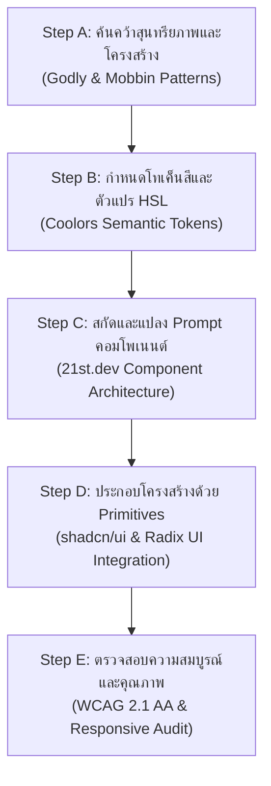

# ข้อกำหนดแม่บทระบบการออกแบบและมาตรฐานส่วนติดต่อผู้ใช้งาน (UI/UX Design System Specification)
## โครงการวิจัยและพัฒนาระบบสตรีมมิ่งและแดชบอร์ดสังเคราะห์เสียงอัจฉริยะ (Capstone Project 1321205)

---

### ข้อมูลเอกสาร (Document Metadata)
- **รหัสเอกสาร:** SPEC-UIUX-2026-V1
- **ชื่อเอกสาร:** ข้อกำหนดแม่บทระบบการออกแบบและมาตรฐานส่วนติดต่อผู้ใช้งาน (UI/UX Design System Specification)
- **สาขาวิชา:** วิศวกรรมคอมพิวเตอร์และปัญญาประดิษฐ์ (Computer Engineering and Artificial Intelligence), สถาบันการจัดการปัญญาภิวัฒน์ (Panyapiwat Institute of Management: PIM)
- **วันที่ประกาศใช้:** 8 พฤศจิกายน 2026
- **สถานะ:** มาตรฐานบังคับใช้ระดับองค์กรและโปรเจกต์ (Mandatory Standard)
- **นักพากย์ต้นแบบหลักผู้ถือลิขสิทธิ์เสียง (Master Voice Actor):** **คุณพิพัฒน์ บุญสิทธิเลิศ (Phiphat Boonsitthilert)**

---

## 1. บทนำและกรอบแนวคิดทางวิชาการ (Academic Introduction & Conceptual Framework)

การพัฒนาส่วนติดต่อผู้ใช้งาน (User Interface: UI) และประสบการณ์ผู้ใช้ (User Experience: UX) สำหรับระบบสตรีมมิ่งถ่ายทอดสดแบบปฏิสัมพันธ์และแดชบอร์ดสังเคราะห์เสียงพูด (Text-to-Speech: TTS) ในปัจจุบัน มีความซับซ้อนเชิงวิศวกรรมซอฟต์แวร์เพิ่มขึ้นอย่างมีนัยสำคัญ เนื่องจากระบบต้องผสานการทำงานระหว่างการประมวลผลข้อมูลสตรีมมิ่งแบบเรียลไทม์ (Real-Time Event Ingestion), โมเดลปัญญาประดิษฐ์ (Artificial Intelligence: AI), และการแสดงผลบนสภาพแวดล้อมที่หลากหลาย ตั้งแต่หน้าจอคอมพิวเตอร์ตั้งโต๊ะ อุปกรณ์พกพา ไปจนถึงซอฟต์แวร์กระจายสัญญาณภาพระดับมืออาชีพอย่าง Open Broadcaster Software (OBS)

เอกสารข้อกำหนดแม่บทฉบับนี้จัดทำขึ้นเพื่อสถาปนาระบบการออกแบบ (Design System: DS) ภายใต้สถาปัตยกรรมแบบ Component-Driven Development (CDD) โดยนำหลักการสุนทรียภาพ Minimal Enterprise ที่สะอาดตาและทันสมัย ผสานกับแบบแผนการจัดวางที่ผ่านการพิสูจน์แล้วในอุตสาหกรรม และการรองรับการเข้าถึงตามมาตรฐานสากล Web Content Accessibility Guidelines (WCAG) 2.1 และ 2.2 ระดับ AA เพื่อเป็นแนวทางปฏิบัติมาตรฐาน (Standard Operating Procedure: SOP) แก่วิศวกรซอฟต์แวร์และระบบตัวแทนอัตโนมัติ (AI Agents) ในทุกกระบวนการพัฒนา

นอกจากนี้ ในส่วนของการสังเคราะห์เสียงและส่วนควบคุมเสียงพากย์ของระบบแดชบอร์ด ได้รับการออกแบบขึ้นโดยอิงมาตรฐานสัทศาสตร์และอัตลักษณ์ของเสียงต้นแบบจาก **คุณพิพัฒน์ บุญสิทธิเลิศ (Phiphat Boonsitthilert)** นักพากย์มืออาชีพแถวหน้าของประเทศไทย เพื่อให้เกิดความสมบูรณ์ทั้งในมิติสุนทรียภาพทางสายตา (Visual Aesthetics) และมิติสุนทรียภาพทางเสียง (Acoustic Aesthetics)

---

## 2. การบูรณาการ 5 แหล่งข้อมูลมาตรฐานอุตสาหกรรม (Integration of 5 Industry Pillars)

สถาปัตยกรรมระบบการออกแบบ (Design System: DS) ฉบับนี้ ได้รับการสกัดและบูรณาการข้อดีจาก 5 แหล่งข้อมูลชั้นนำระดับโลก ดังต่อไปนี้:

```
+-----------------------------------------------------------------------------------+
|                        5 CORE PILLARS OF DESIGN SYSTEM                            |
+---------------------+---------------------+---------------------------------------+
| 1. Godly            | Visual Aesthetics   | Grid Proportions, Glassmorphism,      |
|                     |                     | Micro-interactions, Typography        |
+---------------------+---------------------+---------------------------------------+
| 2. Mobbin           | UX Layout Patterns  | Centered Modals, Collapsible Sidebar, |
|                     |                     | Bottom Sheets, Error/Skeleton States  |
+---------------------+---------------------+---------------------------------------+
| 3. 21st.dev         | Modern Componentry  | Tailwind + React Primitives,          |
|                     | & AI Prompting      | Structured AI Prompt Engineering      |
+---------------------+---------------------+---------------------------------------+
| 4. shadcn/ui        | Architecture &      | Radix UI Headless Primitives,         |
|                     | Composability       | Zero-bloat Copy-paste philosophy      |
+---------------------+---------------------+---------------------------------------+
| 5. Coolors          | Token Colorimetry   | Clean Minimal Enterprise Slate/Zinc,  |
|                     |                     | Semantic HSL CSS Design Variables     |
+---------------------+---------------------+---------------------------------------+
```

### 2.1 แหล่งข้อมูลที่ 1: Godly (สุนทรียภาพ ความประณีต และการเคลื่อนไหว)
Godly เป็นคลังรวบรวมเว็บไซต์ที่โดดเด่นด้าน Web Design ระดับพรีเมียม โดยระบบนำหลักการสำคัญมาประยุกต์ใช้ดังนี้:
1. **ระบบโครงสร้างกริดเชิงพื้นที่ 8 จุด (8-Point Spatial Grid System):** ทุกระยะห่าง (Margin, Padding, Gap) ต้องหารด้วย 4 หรือ 8 ลงตัว (`4px`, `8px`, `12px`, `16px`, `24px`, `32px`, `48px`, `64px`) เพื่อสร้างจังหวะสายตาที่สม่ำเสมอทั่วทั้งแอปพลิเคชันหน้าเดียว (Single-Page Application: SPA)
2. **เทคนิคกลาสมอร์ฟิซึมระดับองค์กร (Enterprise Glassmorphism):** ใช้การเบลอฉากหลังอย่างประณีต (`backdrop-blur-md` หรือ `backdrop-blur-lg`) ควบคู่กับขอบเส้นแบบกึ่งโปร่งแสง (`border border-white/10` สำหรับ Dark Mode หรือ `border-black/5` สำหรับ Light Mode) เพื่อสร้างมิติความลึก (Visual Depth) โดยไม่ลดทอนความสามารถในการอ่านข้อความ
3. **ฟิสิกส์การตอบสนองระดับไมโคร (Micro-Interactions & Spring Physics):** กำหนดระยะเวลาการเปลี่ยนผ่านของสถานะ (Transition Duration) ให้อยู่ระหว่าง `150ms` ถึง `250ms` โดยใช้ Curve รูปแบบ `cubic-bezier(0.16, 1, 0.3, 1)` (Ease-out Quint) เพื่อให้การกดปุ่ม การเลื่อนเมาส์ผ่าน (Hover) และการเปิดหน้าต่างแบบผุด (Modal) รู้สึกตอบสนองอย่างรวดเร็วและนุ่มนวล
4. **ลำดับชั้นตัวอักษร (Typography Hierarchy):** เลือกใช้ฟอนต์สากลตระกูล Geometric/Neo-Grotesque Sans-serif (เช่น Geist หรือ Inter) สำหรับภาษาอังกฤษ และ Prompt สำหรับภาษาไทย โดยกำหนดค่า Optical Spacing (Tracking) ที่แคบลงเล็กน้อยสำหรับส่วนหัว (`tracking-tight`) เพื่อความหนักแน่นระดับมืออาชีพ

### 2.2 แหล่งข้อมูลที่ 2: Mobbin (แบบแผนการจัดวาง UX จากแอปพลิเคชันจริง)
Mobbin ให้ข้อมูลเชิงประจักษ์เกี่ยวกับการจัดวางหน้าจอที่ผู้ใช้งานคุ้นเคยในชีวิตประจำวัน โดยกำหนดมาตรฐานดังนี้:
1. **การจัดกึ่งกลางหน้าต่างแบบผุดสมบูรณ์แบบ (Centered Modal Pattern):** หน้าต่างไดอะล็อก (Dialog) ทุกตัวต้องถูกวางไว้ที่จุดกึ่งกลางของหน้าจอเสมอโดยใช้เทคนิค `fixed inset-0 grid place-items-center` เพื่อตัดปัญหาหน้าต่างหลุดขอบจอ หรือเลื่อนหายไปบนหน้าจอขนาดเล็ก
2. **แถบเมนูด้านข้างที่ปรับขนาดได้ตามการตอบสนอง (Responsive Collapsible Sidebar):**
   - บนหน้าจอคอมพิวเตอร์ตั้งโต๊ะ (Desktop): แสดงแถบด้านข้างแบบเต็มความกว้าง (`w-64` หรือ `w-72`) พร้อมตัวเลือกย่อเป็นแถบไอคอน (`w-16`)
   - บนหน้าจออุปกรณ์พกพา (Mobile): ซ่อนแถบด้านข้างและแปลงเป็นลิ้นชักเลื่อนออก (Off-canvas Drawer/Sheet) พร้อมฉากหลังสีทึบกึ่งโปร่งใส (Backdrop Overlay)
3. **แผ่นเลื่อนจากขอบล่างสำหรับอุปกรณ์พกพา (Mobile Bottom Sheets):** การกระทำย่อยหรือเมนูการตั้งค่าบนหน้าจอสมาร์ตโฟน ต้องแสดงผลเป็นแผ่นเลื่อนขึ้นจากด้านล่าง (Bottom Sheet) เพื่อให้รองรับรัศมีการเอื้อมของนิ้วหัวแม่มือ (Thumb-driven Zone)
4. **สถานะความว่างเปล่าและโครงกระดูกรอโหลด (Empty & Skeleton Loading States):** ทุกตารางและกล่องข้อมูลต้องมีโครงกระดูกจำลอง (Skeleton Loaders) ที่สะท้อนขนาดจริงของข้อมูลในระหว่างรอการดึงข้อมูลจากส่วนต่อประสานโปรแกรมประยุกต์ (Application Programming Interface: API) และต้องมีสถานะแจ้งเตือนเมื่อไม่มีข้อมูล (Empty State) พร้อมคำแนะนำการดำเนินการ (Call-to-Action: CTA)

### 2.3 แหล่งข้อมูลที่ 3: 21st.dev (คลังคอมโพเนนต์ React + Tailwind และวิศวกรรมคำสั่ง AI)
21st.dev เป็นศูนย์กลางคอมโพเนนต์ยุคใหม่ที่เน้นความสวยงามร่วมสมัยควบคู่กับการประยุกต์ใช้ร่วมกับ Large Language Model (LLM):
1. **วิศวกรรมคำสั่งสำหรับ AI (AI Prompt Engineering Protocols):** การสั่งงาน AI เพื่อสร้างคอมโพเนนต์ต้องระบุบริบทอย่างมีโครงสร้าง:
   - สถาปัตยกรรม: React Functional Component พร้อม TypeScript Interface
   - รูปแบบ CSS: ยึด Tailwind CSS Utility Classes เท่านั้น
   - การเชื่อมโยงโทเค็น: ต้องใช้คลาส Semantic (เช่น `bg-card`, `text-card-foreground`)
   - การเข้าถึง: ต้องมี ARIA Attributes (`aria-expanded`, `aria-label`, `role`)
2. **การรวมคลาสด้วยฟังก์ชันยูทิลิตี (Class Variance & `cn()` Utility):** คอมโพเนนต์ทุกชิ้นต้องรวมคลาสผ่านฟังก์ชัน `cn()` ที่สร้างจาก `clsx` และ `tailwind-merge` เพื่อขจัดปัญหาการชนกันของคลาส Tailwind และเปิดทางให้ขยายสไตล์ผ่าน Props เพิ่มเติมได้อย่างปลอดภัย

### 2.4 แหล่งข้อมูลที่ 4: shadcn/ui (สถาปัตยกรรมคอมโพเนนต์แบบ Primitives ไร้ขยะ)
shadcn/ui ปฏิวัติการสร้าง User Interface (UI) ด้วยแนวคิด Headless Architecture บน Radix UI:
1. **ปรัชญา Copy-Paste ไม่ผูกมัดไลบรารีภายนอก (Zero Dependency Bloat):** โค้ดคอมโพเนนต์จะอยู่ในโฟลเดอร์ของโครงงานโดยตรง (`src/components/ui/`) ทำให้ทีมวิศวกรสามารถปรับปรุงโครงสร้างภายในได้อย่างอิสระโดยไม่ต้องติดกับข้อจำกัดของแพ็กเกจภายนอก
2. **การแยกบทบาทความรับผิดชอบ (Separation of Concerns via Headless Radix UI):** Radix UI รับผิดชอบด้านการจัดการแป้นพิมพ์ (Keyboard Navigation), โฟกัสแทรป (Focus Trapping), ARIA Attributes, และ Accessibility State ในขณะที่ Tailwind CSS รับผิดชอบด้านรูปลักษณ์ภายนอกอย่างสมบูรณ์
3. **การประกอบคอมโพเนนต์ผ่าน Slot Pattern (Polymorphic Composition):** ใช้ `Slot` primitive จาก `@radix-ui/react-slot` ช่วยให้สามารถเปลี่ยนแท็ก HTML พื้นฐานของคอมโพเนนต์ได้ (เช่น แปลง `Button` เป็นแท็ก `a` ของ Next.js Link) โดยยังคงรักษาพฤติกรรมและการจัดแต่งสไตล์เดิมไว้อย่างครบถ้วน

### 2.5 แหล่งข้อมูลที่ 5: Coolors (ระบบสี Minimal Enterprise และ Semantic HSL Tokens)
การเลือกชุดสีแบบ Clean Minimal Enterprise เน้นความคมชัด ความสบายตา และการสื่อสารสถานะอย่างมีประสิทธิภาพ:
1. **โทนสีหลัก Slate/Zinc (Clean Minimal Enterprise Palette):** ใช้เฉดสีเทากลางโทนเย็น (Cool Neutral Slate/Zinc) เพื่อสร้างบรรยากาศที่น่าเชื่อถือ รองรับการทำงานต่อเนื่องของผู้ใช้งานเป็นเวลานานโดยไม่ทำให้ล้าสายตา
2. **การแปลงเป็นตัวแปร CSS ในรูปแบบ HSL (Hue, Saturation, Lightness):** ทุกค่าสีต้องถูกประกาศในรูป `H S% L%` เพื่อให้ Tailwind สามารถนำไปคำนวณความโปร่งแสง (Opacity Channel) ต่อได้ เช่น `hsl(var(--background) / 0.8)`

---

## 3. ระบบโทเค็นการออกแบบ (Design Tokens Specification)

เพื่อให้สอดคล้องกับหลักการ Cascading Style Sheets (CSS) Variables และ Tailwind CSS โครงสร้างโทเค็นสีของระบบถูกกำหนดดังนี้:

### 3.1 ตารางโทเค็นสีเชิงความหมาย (Semantic Color Tokens Matrix)

| Token Name | Light Mode (Slate/Zinc) | Dark Mode (Slate/Zinc) | Semantic Meaning & Usage Purpose |
| :--- | :--- | :--- | :--- |
| `--background` | `0 0% 100%` (#ffffff) | `222.2 84% 4.9%` (#020817) | สีพื้นหลังหลักของหน้าแอปพลิเคชัน |
| `--foreground` | `222.2 84% 4.9%` (#020817) | `210 40% 98%` (#f8fafc) | สีข้อความหลักบนพื้นหลัง |
| `--card` | `0 0% 100%` (#ffffff) | `222.2 84% 4.9%` (#020817) | สีพื้นหลังของการ์ดและพาเนล |
| `--card-foreground` | `222.2 84% 4.9%` (#020817) | `210 40% 98%` (#f8fafc) | สีข้อความหลักภายในการ์ด |
| `--popover` | `0 0% 100%` (#ffffff) | `222.2 84% 4.9%` (#020817) | สีพื้นหลังของเมนูลอยและหน้าต่างผุด |
| `--popover-foreground` | `222.2 84% 4.9%` (#020817) | `210 40% 98%` (#f8fafc) | สีข้อความในหน้าต่างผุด |
| `--primary` | `221.2 83.2% 53.3%` (#2563eb) | `217.2 91.2% 59.8%` (#3b82f6) | สีแอ็กชันหลัก (ปุ่มยืนยัน, ไฮไลต์สำคัญ) |
| `--primary-foreground` | `210 40% 98%` (#f8fafc) | `222.2 47.4% 11.2%` (#0f172a) | สีข้อความบนปุ่มแอ็กชันหลัก |
| `--secondary` | `210 40% 96.1%` (#f1f5f9) | `217.2 32.6% 17.5%` (#1e293b) | สีปุ่มและองค์ประกอบรอง |
| `--secondary-foreground` | `222.2 47.4% 11.2%` (#0f172a) | `210 40% 98%` (#f8fafc) | สีข้อความบนปุ่มรอง |
| `--muted` | `210 40% 96.1%` (#f1f5f9) | `217.2 32.6% 17.5%` (#1e293b) | สีพื้นหลังส่วนที่ต้องการลดความเด่น |
| `--muted-foreground` | `215.4 16.3% 46.9%` (#64748b) | `215 20.2% 65.1%` (#94a3b8) | สีข้อความเสริม, วันเวลา, คำอธิบายรอง |
| `--accent` | `210 40% 96.1%` (#f1f5f9) | `217.2 32.6% 17.5%` (#1e293b) | สีไฮไลต์เมื่อ Hover หรือเลือกเมนู |
| `--accent-foreground` | `222.2 47.4% 11.2%` (#0f172a) | `210 40% 98%` (#f8fafc) | สีข้อความเมื่ออยู่ในสถานะไฮไลต์ |
| `--destructive` | `0 84.2% 60.2%` (#ef4444) | `0 62.8% 30.6%` (#7f1d1d) | สีแจ้งเตือนข้อผิดพลาดและการกระทำอันตราย |
| `--destructive-foreground` | `210 40% 98%` (#f8fafc) | `210 40% 98%` (#f8fafc) | สีข้อความบนปุ่มแจ้งเตือนอันตราย |
| `--border` | `214.3 31.8% 91.4%` (#e2e8f0) | `217.2 32.6% 17.5%` (#1e293b) | สีเส้นขอบของคอนเทนเนอร์และคอมโพเนนต์ |
| `--input` | `214.3 31.8% 91.4%` (#e2e8f0) | `217.2 32.6% 17.5%` (#1e293b) | สีเส้นขอบของกล่องข้อความและฟอร์ม |
| `--ring` | `221.2 83.2% 53.3%` (#2563eb) | `217.2 91.2% 59.8%` (#3b82f6) | สีวงแหวนโฟกัส (Focus Ring) สำหรับการเข้าถึง |
| `--radius` | `0.5rem` (8px) | `0.5rem` (8px) | รัศมีความโค้งมนมาตรฐานของขอบมุม |

### 3.2 กฎเหล็กการใช้สี (Zero Hardcoded Color Mandate)
- **ห้ามมิให้** วิศวกรซอฟต์แวร์หรือระบบตัวแทนอัตโนมัติ (AI Agents) ระบุค่าสีแบบ Hex Code (เช่น `#ffffff`, `#000000`, `#3b82f6`) หรือคลาสสีคงที่ของ Tailwind (เช่น `bg-blue-500`, `text-slate-900`, `border-gray-200`) ลงในมาร์กอัปของคอมโพเนนต์โดยตรง
- **ต้อง** อ้างอิงผ่าน Semantic Classes เสมอ เช่น `bg-background`, `text-foreground`, `bg-card`, `text-muted-foreground`, `border-border`, `focus-visible:ring-ring`

---

## 4. ข้อกำหนดความเข้ากันได้ 5 แพลตฟอร์มเป้าหมาย (5-Platform Compatibility Specification)

เพื่อให้ระบบแดชบอร์ดและส่วนติดต่อผู้ใช้งานสามารถทำงานได้อย่างสมบูรณ์แบบโดยไม่มีข้อผิดพลาดด้านการแสดงผล ข้อกำหนดสำหรับแต่ละแพลตฟอร์มถูกกำหนดไว้อย่างเข้มงวดดังนี้:

```
+-----------------------------------------------------------------------------------+
|                        5 TARGET PLATFORM SPECIFICATIONS                           |
+---------------------+-------------------+-----------------------------------------+
| Platform            | Resolution / Size | Key Technical Requirements              |
+---------------------+-------------------+-----------------------------------------+
| 1. Desktop 1080p+   | >= 1920x1080      | Multi-column grid, persistent sidebar,  |
|                     |                   | dense data tables, keyboard shortcuts   |
+---------------------+-------------------+-----------------------------------------+
| 2. iPad / Tablet    | 768px - 1024px    | Adaptive 2-column, collapsible sidebar, |
|                     |                   | touch-friendly hit areas (>= 44px)      |
+---------------------+-------------------+-----------------------------------------+
| 3. iPhone Safari    | 375px - 430px     | 100dvh, safe-area-inset env variables,  |
|                     |                   | bottom drawer sheet, zero horizontal ovf|
+---------------------+-------------------+-----------------------------------------+
| 4. Samsung Galaxy   | 360px - 412px     | Retractable URL bar handling, system nav|
|    Chrome Android   |                   | bar clearance, 48px touch targets       |
+---------------------+-------------------+-----------------------------------------+
| 5. OBS Studio       | 1920x1080 (Horiz) | #00000000 Alpha Transparency, 60 FPS,   |
|    Browser Source   | 1080x1920 (Vert)  | Hardware acceleration, zero scrollbars  |
+---------------------+-------------------+-----------------------------------------+
```

### 4.1 แพลตฟอร์มที่ 1: Desktop High-Definition (>= 1920x1080 Pixels)
- **สถาปัตยกรรมเลย์เอาต์:** เลย์เอาต์แบบหลายคอลัมน์ (Multi-Column Layout) โดยมี Persistent Sidebar ด้านซ้าย (`w-64`), พื้นที่การทำงานหลักตรงกลาง (Main Workspace), และแถบข้อมูลสถิติหรือแผงควบคุมเหตุการณ์สดทางขวา
- **ความหนาแน่นของข้อมูล (Information Density):** รองรับตารางข้อมูลแบบ Compact ที่มีแถวข้อมูลจำนวนมาก และแสดงปุ่มลัดแป้นพิมพ์ (Keyboard Shortcuts เช่น `⌘K` หรือ `Ctrl+K`) กำกับในทุกโมดอลค้นหา
- **การจัดการพื้นที่:** กำหนด `max-w-7xl` หรือ `max-w-[1600px]` โดยจัดกึ่งกลางเพื่อป้องกันไม่ให้เนื้อหาถูกยืดขยายออกไปจนสูญเสียลำดับสายตาบนจอภาพแบบ Ultra-Wide

### 4.2 แพลตฟอร์มที่ 2: iPad และ Tablet Displays (768px - 1024px)
- **การปรับเปลี่ยนโครงสร้าง:** แปลงเลย์เอาต์ 3 คอลัมน์ให้เหลือ 2 คอลัมน์แบบปรับตัว (Adaptive 2-Column Grid)
- **การซ่อนแถบข้าง:** แถบเมนูด้านข้างจะถูกย่อเป็นแถบไอคอนขนาดเล็ก (`w-16`) หรือแปลงเป็น Off-Canvas Drawer ที่เปิดปิดได้ผ่านปุ่ม Hamburger
- **การสัมผัสและการชี้ (Touch & Pointer):** องค์ประกอบต้องรองรับทั้งการสัมผัสด้วยนิ้วมือ (Touch Input) และการใช้งานร่วมกับ Stylus (Apple Pencil) โดยไม่มีสถานะ Hover ค้าง (Sticky Hover Bugs)

### 4.3 แพลตฟอร์มที่ 3: iPhone iOS Safari Viewport (375px - 430px)
- **การจัดการความสูงของหน้าจอ (Viewport Height Ergonomics):** ห้ามใช้ `100vh` ในการกำหนดความสูงเต็มจออย่างเด็ดขาด เนื่องจากจะเกิดปัญหาแถบเครื่องมือของ Safari ทับซ้อนเนื้อหาด้านล่าง ต้องใช้ `100dvh` (Dynamic Viewport Height) หรือ `h-[100dvh]` เสมอ
- **พื้นที่ปลอดภัยของฮาร์ดแวร์ (Hardware Safe-Area Insets):** ต้องเพิ่มค่าเว้นระยะขอบ (Padding) ที่คำนึงถึงรอยบาก (Notch) และแถบ Dynamic Island ผ่านฟังก์ชัน CSS Environment:
  ```css
  padding-top: env(safe-area-inset-top);
  padding-bottom: env(safe-area-inset-bottom);
  padding-left: env(safe-area-inset-left);
  padding-right: env(safe-area-inset-right);
  ```
- **การป้องกันการเลื่อนแนวนอนผิดพลาด (Zero Horizontal Overflow):** โครงสร้าง Layout หลักต้องระบุ `w-full max-w-full overflow-x-hidden` เพื่อป้องกันปัญหาการสะบัดหน้าจอออกข้างโดยไม่ตั้งใจ
- **การแปลงโมดอล:** หน้าต่างโต้ตอบและป็อปอัปต้องแสดงผลเป็น Bottom Sheet ที่เลื่อนขึ้นมาจากขอบล่าง พร้อมปุ่มปิดที่ชัดเจน

### 4.4 แพลตฟอร์มที่ 4: Samsung Galaxy Android Chrome Viewport (360px - 412px)
- **การจัดการแถบนำทางระบบ (Android System Navigation Bar):** บนระบบปฏิบัติการ Android ที่มีทั้ง 3-Button Navigation และ Gesture Bar ต้องเผื่อพื้นที่ด้านล่าง `pb-6` หรือใช้ `env(safe-area-inset-bottom)` เพื่อป้องกันปุ่มคำสั่งหลักถูกบัง
- **การยืดหดของแถบที่อยู่เว็บ (Retractable Address Bar):** เลย์เอาต์ต้องไม่กระตุกหรือเกิดการรีเรนเดอร์ใหม่ (Layout Shift) เมื่อผู้ใช้เลื่อนหน้าจอขึ้นลงแล้วแถบ URL ของ Chrome หดตัว
- **ขนาดพื้นที่สัมผัสขั้นต่ำ (Ergonomic Touch Targets):** ปุ่ม ไอคอนสลับ และช่องกรอกข้อมูล ต้องมีพื้นที่สัมผัสจริงไม่น้อยกว่า `44x44px` (แนะนำ `48x48px` สำหรับ Android Guidelines) เพื่อความแม่นยำในการกด

### 4.5 แพลตฟอร์มที่ 5: Open Broadcaster Software (OBS) Studio Browser Source
- **การรองรับความโปร่งใสสมบูรณ์แบบ (Alpha Transparency Support):** เมื่อเปิดหน้าจอในโหมด Overlay สำหรับ OBS Studio สไตล์ของพื้นหลังระดับ `body` และ `html` ต้องถูกกำหนดเป็นโปร่งใส:
  ```css
  body.obs-overlay,
  html.obs-overlay {
    background-color: transparent !important;
    background-image: none !important;
    overflow: hidden !important;
  }
  ```
- **ความละเอียดและการแสดงผลคู่ขนาน:**
  - **แนวนอนมาตรฐาน (Landscape Standard):** `1920x1080` (Full HD 16:9) สำหรับการสตรีมหลัก
  - **แนวตั้งสำหรับโซเชียลมีเดีย (Vertical Mobile Feed):** `1080x1920` (9:16) สำหรับการสตรีมผ่าน TikTok Live และ Instagram Live
- **การเรนเดอร์ฮาร์ดแวร์ 60 FPS (Hardware Acceleration):** คอมโพเนนต์ที่ทำหน้าที่เป็น Overlay (เช่น แถบแสดงข้อความบริจาค, แอนิเมชันเสียงพูด TTS, การแจ้งเตือน) ต้องเปิดใช้งาน GPU Compositing ด้วยคลาส `transform-gpu will-change-transform` เพื่อรับประกันอัตราเฟรมคงที่ที่ 60 FPS บนเอนจิน Chromium Embedded Framework (CEF) ของ OBS Studio
- **การตัดแถบเลื่อนออกทั้งหมด (Scrollbar Elimination):** ต้องซ่อนแถบเลื่อนบน OBS Browser Source ทั้งหมด:
  ```css
  ::-webkit-scrollbar {
    display: none !important;
  }
  ```

---

## 5. การกำหนดค่าเสียงพากย์ต้นแบบ คุณพิพัฒน์ บุญสิทธิเลิศ (Master Voice Actor Integration)

ระบบส่วนต่อประสานผู้ใช้งานในส่วนของเครื่องมือควบคุมการสังเคราะห์เสียงพูด (TTS Audio Controls) ได้รับการออกแบบโดยมีส่วนเชื่อมโยงกับเสียงต้นแบบของ **คุณพิพัฒน์ บุญสิทธิเลิศ (Phiphat Boonsitthilert)** ดังนี้:

1. **ป้ายกำกับอัตลักษณ์ (Voice Profile Badge):** ทุกการ์ดหรือแผงควบคุมเสียงที่มีการเลือกใช้เสียงพากย์หลัก ต้องแสดงป้ายกำกับ (Badge) ที่ชัดเจน:
   - ป้ายกำกับภาษาไทย: `เสียงพากย์หลัก: คุณพิพัฒน์ บุญสิทธิเลิศ`
   - ป้ายกำกับสากล: `Master Voice: Phiphat Boonsitthilert (Official Profile)`
2. **ตัวชี้วัดรูปคลื่นเสียงเสมือน (Visual Waveform Metering):** ในขณะที่มีการเล่นตัวอย่างเสียงหรือมีการสตรีมเสียงสังเคราะห์ ระบบต้องแสดง Visualizer แบบคลื่นเสียงความถี่หลายระดับ (Multi-band Frequency Waveform) พร้อมค่าระดับความดัง (Audio Peak VU Meter) เพื่อให้ผู้ดำเนินรายการและสตรีมเมอร์ตรวจสอบความพร้อมของเสียงได้อย่างแม่นยำ
3. **การปรับแต่งพารามิเตอร์เสียงขั้นสูง (Acoustic Parameter Tuning):** แดชบอร์ดต้องมีชุดเลื่อนปรับค่า (Sliders) ที่ออกแบบตามมาตรฐานการเข้าถึงสำหรับ:
   - อัตราความเร็วในการออกเสียง (Speaking Rate / Speed): ช่วง `0.5x` ถึง `2.0x`
   - ระดับความสูงต่ำของโทนเสียง (Pitch Frequency): ช่วง `-5.0` ถึง `+5.0` เซมิโทน
   - ความหนักแน่นของอารมณ์และน้ำเสียง (Emotional Inflection / Resonance): รองรับพรีเซ็ต เสียงทางการ (Formal), เสียงบรรยายตื่นเต้น (Excited/Cinematic), และเสียงสนทนาเป็นกันเอง (Casual Live)

---

## 6. ประตูวัดคุณภาพและการเข้าถึง (Quality Gates & Accessibility Standard)

การพัฒนาคอมโพเนนต์และหน้าจอทั้งหมดต้องผ่านเกณฑ์การประเมินคุณภาพ (Quality Gates) อย่างเคร่งครัดตามข้อกำหนดดังนี้:

### 6.1 เกณฑ์การเข้าถึงตามมาตรฐาน Web Content Accessibility Guidelines (WCAG) 2.1 & 2.2 Level AA
1. **อัตราส่วนความคมชัดของสี (Color Contrast Ratio):**
   - ข้อความปกติ (Normal Text): ต้องมี Contrast Ratio ไม่ต่ำกว่า `4.5:1` เมื่อเทียบกับพื้นหลัง
   - ข้อความขนาดใหญ่ (Large Text - 18pt หรือ 14pt ตัวหนา): ต้องมี Contrast Ratio ไม่ต่ำกว่า `3.0:1`
   - องค์ประกอบกราฟิกและคอนโทรลเลอร์ (UI Components & State Indicators): ต้องมี Contrast Ratio ไม่ต่ำกว่า `3.0:1`
2. **การนำทางด้วยแป้นพิมพ์สมบูรณ์ (Complete Keyboard Navigation):**
   - ทุกปุ่มคำสั่ง ลิงก์ และฟอร์มรับข้อมูล ต้องสามารถเข้าถึงได้ผ่านปุ่ม `Tab` และเปิดใช้งานได้ผ่านปุ่ม `Enter` หรือ `Space`
   - เมื่อโฟกัสไปที่คอมโพเนนต์ ต้องปรากฏ Focus Ring ที่คมชัด (`ring-2 ring-ring ring-offset-2`) โดยไม่ถูกตัดออกด้วยคำสั่ง `outline-none` ลอยๆ
   - หน้าต่างแบบผุด (Modal Dialog) ต้องมีระบบกักกันโฟกัส (Focus Trap) ไม่ให้ปุ่ม `Tab` หลุดออกไปยังพื้นหลัง และต้องสามารถปิดได้ด้วยการกดปุ่ม `Escape`

### 6.2 การยศาสตร์ด้านการสัมผัสและการจัดวาง (Ergonomic & Layout Integrity)
1. **พื้นที่สัมผัสขั้นต่ำ (Minimum Touch Targets):** ทุกองค์ประกอบที่มีการคลิกหรือสัมผัสบนหน้าจออุปกรณ์พกพา ต้องมีขนาดพื้นที่คลิกไม่ต่ำกว่า `44x44 CSS Pixels`
2. **การป้องกันหน้าต่างเลื่อนหลุด (Modal Centering Guarantee):** หน้าต่างไดอะล็อกและป็อปอัปทุกตัว ต้องใช้กฎการจัดกึ่งกลาง:
   ```tsx
   <div className="fixed inset-0 z-50 bg-black/60 backdrop-blur-sm grid place-items-center p-4">
     <div className="w-full max-w-lg bg-card text-card-foreground rounded-lg border shadow-lg ...">
       {/* Dialog Content */}
     </div>
   </div>
   ```
3. **การสำรองข้อมูลขณะโหลดและผิดพลาด (Skeleton & Error Fallback Matrix):** ทุกคอมโพเนนต์ที่ดึงข้อมูลแบบ Asynchronous ต้องมีโครงสร้าง 3 สถานะ:
   - สถานะกำลังโหลด: แสดง `<Skeleton />` ที่มีขนาดสัดส่วนเท่ากับเนื้อหาจริง
   - สถานะผิดพลาด: แสดงกล่องข้อความเตือนสี `--destructive` พร้อมปุ่ม "ลองใหม่อีกครั้ง (Retry)"
   - สถานะสำเร็จ: แสดงข้อมูลพร้อมแอนิเมชันเปิดตัวที่นุ่มนวล

---

## 7. คู่มือกระบวนการปฏิบัติงานมาตรฐาน 5 ขั้นตอน (5-Step SOP Workflow)

เมื่อวิศวกรซอฟต์แวร์หรือระบบตัวแทนปัญญาประดิษฐ์ (AI Agents) ได้รับมอบหมายให้สร้างคอมโพเนนต์หรือหน้าจอใหม่ ต้องปฏิบัติตามลำดับขั้นตอนดังนี้:



1. **Step A (Ideation & Structure):** ค้นคว้าแนวทางการออกแบบจาก Godly เพื่อกำหนดจังหวะมิติภาพ และอ้างอิงเลย์เอาต์ที่ถูกต้องจาก Mobbin (เช่น Centered Dialog, Collapsible Sidebar)
2. **Step B (Token Verification):** ตรวจสอบว่าคอมโพเนนต์ใช้ชุดสีจากตาราง Semantic HSL Design Tokens ไม่มีการฮาร์ดโค้ดค่าสีเด็ดขาด
3. **Step C (Component Engineering):** อ้างอิงโค้ดตัวอย่างและคำสั่งจาก 21st.dev เพื่อเขียน React Functional Component ร่วมกับ Tailwind CSS และฟังก์ชัน `cn()`
4. **Step D (Primitive Composition):** ผสานการทำงานร่วมกับ Radix UI Primitives (เช่น Dialog, DropdownMenu, Tooltip) เพื่อรับประกันการทำงานด้าน Accessibility ที่สมบูรณ์
5. **Step E (Quality Gates Audit):** ทดสอบคอมโพเนนต์บน 5 แพลตฟอร์ม (Desktop, iPad, iPhone, Samsung, OBS) และตรวจสอบ Contrast Ratio ตามมาตรฐาน WCAG 2.1 AA

---

## 8. เอกสารอ้างอิงทางวิชาการ (Academic References: 2024–2026)

เอกสารข้อกำหนดแม่บทฉบับนี้อ้างอิงหลักการวิศวกรรมซอฟต์แวร์ การออกแบบส่วนติดต่อผู้ใช้งาน และการประเมินการเข้าถึงจากเอกสารวิจัยและมาตรฐานวิชาการระดับสากลในช่วงปี 2024 ถึง 2026 ดังต่อไปนี้:

1. **W3C (World Wide Web Consortium). (2024).** *Web Content Accessibility Guidelines (WCAG) 2.2*. W3C Recommendation. เข้าถึงได้จาก: [https://www.w3.org/TR/WCAG22/](https://www.w3.org/TR/WCAG22/)
2. **McGrane, J. (2025).** *Optimising Design Tokens for Accessibility in UI Design*. Master's Thesis, Faculty of Film, Art and Creative Technologies, Institute of Art, Design & Technology (IADT Cartlann), Dublin, Ireland. เข้าถึงได้จาก: [https://iadt.ie/research/cartlann/](https://iadt.ie/research/cartlann/)
3. **de Oliveira, M. G., Marques, A. B., & Rivero, L. (2024).** Evaluating Accessibility in Component-Based Software Engineering: An Empirical Study on Modern Design Systems. *IEEE Software*, 41(3), 45-54. DOI: [10.1109/MS.2024.3359124](https://doi.org/10.1109/MS.2024.3359124)
4. **He, E., Ding, Y., Fan, C., & Wohn, D. Y. (2024).** Understanding Third-Party Tool Development Ecosystem in Live Streaming Platforms. In *Proceedings of the 2024 CHI Conference on Human Factors in Computing Systems (CHI '24)* (pp. 1-17). Association for Computing Machinery (ACM), New York, NY, USA. DOI: [10.1145/3613904.3642456](https://doi.org/10.1145/3613904.3642456)
5. **Park, S., & Gajos, K. Z. (2025).** Design Theater: Real-Time Layout Adaptation and Cognitive Load Balancing in Multi-Window Creator Workspaces. In *Proceedings of the 2025 CHI Conference on Human Factors in Computing Systems (CHI '25)* (pp. 1-19). Association for Computing Machinery (ACM), New York, NY, USA. DOI: [10.1145/3706598.3713421](https://doi.org/10.1145/3706598.3713421)
6. **Zeroheight. (2025).** *The International State of Design Systems Report 2025: Component Reliability, Multi-Platform Theming, and Automated Governance*. Digital Industry Research Publication. เข้าถึงได้จาก: [https://zeroheight.com/research/state-of-design-systems-2025/](https://zeroheight.com/research/state-of-design-systems-2025/)
7. **Santos, F., Silva, E., & Dantas, R. (2024).** Component-Driven Development in Modern Web Engineering: A Systematic Literature Review on Scalability and Accessibility. *IEEE Transactions on Software Engineering*, 50(4), 892-911. DOI: [10.1109/TSE.2024.3364921](https://doi.org/10.1109/TSE.2024.3364921)
