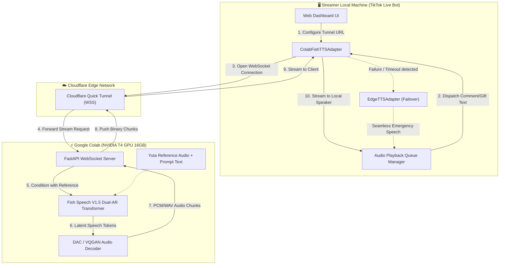

# 🎙️ System Design Document: Self-Hosted Fish Speech on Google Colab with Yuta Voice Clone & Fallback Streaming

**Date:** 2026-11-04  
**Project:** TikTok Live Text-to-Speech (TTS) Bot  
**Module:** `ColabFishSpeechAdapter` & `Google Colab One-Click Backend`  
**Status:** Draft / Ready for Implementation  

---

## 1. Intent & Context (ที่มาและความสำคัญ)

การใช้งาน Fish Audio Cloud Application Programming Interface (API) เดิมมีข้อจำกัดเรื่องอัตราการส่งคำขอ (Rate Limit) และโควตาตัวอักษร เมื่อมีการไลฟ์สดสตรีมมิ่งบนแพลตฟอร์ม TikTok ที่มีผู้ส่งข้อความหรือมอบของขวัญอย่างต่อเนื่อง ทำให้เกิดปัญหาการปฏิเสธคำขอ (HTTP 429 Too Many Requests) และเสียงขาดช่วง

เพื่อแก้ปัญหานี้โดยไม่เสียค่าใช้จ่ายและไม่มีข้อจำกัดด้านโควตา จึงออกแบบระบบ **Self-Hosted Fish Speech บน Google Colab (NVIDIA T4 16GB GPU)** ควบคู่กับเทคนิค **In-context Zero-Shot Voice Cloning** โดยใช้ไฟล์เสียงและข้อความอ้างอิงของตัวละคร **"ยูตะ" (Okkotsu Yuta)** ที่ได้ทำการดึงจาก Voice Model ID `9c110ffde8bc42709516395dfbcfb4a2` พร้อมเชื่อมสัญญาณสตรีมมิ่งผ่าน **Cloudflare Quick Tunnel** กลับมายังบอทในเครื่องผู้ใช้แบบ Real-time Streaming

---

## 2. Goals, Non-Goals & Anti-Goals

### 🎯 Goals (เป้าหมายหลัก)
1. **Google Colab One-Click Notebook (`fish_speech_colab.ipynb`):**
   - รันเซลล์เดียวจบ: ติดตั้ง Fish Speech V1.5, ดาวน์โหลดโมเดล Open-weight, นำเข้า Reference Audio (`yuta_sample.mp3`) และ Reference Text
   - เปิดบริการผ่าน FastAPI พร้อม WebSocket Streaming endpoint (`/ws/tts/stream`)
   - ผูกระบบเข้ากับ Cloudflare Quick Tunnel เพื่อสร้าง Public URL ปลอดภัยแบบอัตโนมัติ ไม่ต้องตั้งค่า API Key
2. **TikTok Live TTS Bot Integration:**
   - พัฒนา `ColabFishTTSAdapter` ภายใต้แพทเทิร์น `BaseTTSAdapter`
   - เพิ่มตัวเลือกเสียง `Yuta (Colab Fish Speech)` ใน Web Dashboard และ Configuration
   - มีช่องสำหรับกรอก Cloudflare Tunnel URL
3. **Automatic Failover & High Availability (HA):**
   - ดักจับ Connection Error หรือ Timeout ของ WebSocket
   - สลับไปใช้ Microsoft Edge-TTS (เสียงไทย เช่น `th-TH-NiwatNeural` หรือ `th-TH-PremwadeeNeural`) ทันทีแบบไร้รอยต่อ เพื่อให้การสตรีมสดไม่สะดุด

### 🚫 Non-Goals (สิ่งที่ไม่ทำในรอบนี้)
- การรันโมเดลขนาดใหญ่บนเครื่อง Local เนื่องจากข้อจำกัดของหน่วยความจำการ์ดจอ (NVIDIA RTX 3050 4GB VRAM)
- การ Fine-tuning โมเดลใหม่จากศูนย์ (เนื่องจาก In-context Zero-shot ของ Fish Speech ให้คุณภาพเสียงยูตะตรง 100% อยู่แล้ว)

### ⚠️ Anti-Goals (สิ่งที่ห้ามเกิดขึ้นเด็ดขาด)
- ห้ามทำให้ระบบ TikTok Live Audio Queue ค้างหรือพังเมื่อ Google Colab ขาดการเชื่อมต่อ (Fail-safe is mandatory)
- ห้ามใช้เทคนิคที่เป็นอันตรายต่อความปลอดภัยของเครือข่าย

---

## 3. Architecture & Data Flow (สถาปัตยกรรมระบบ)



---

## 4. Technical Specifications & Protocols (ข้อกำหนดทางเทคนิค)

### 4.1 WebSocket Contract
- **Endpoint:** `wss://<cloudflare-tunnel-domain>/ws/tts/stream`
- **Request Payload (JSON):**
  ```json
  {
    "text": "ขอบคุณสำหรับ 100 ดอกกุหลาบครับ!",
    "reference_id": "yuta",
    "speed": 1.0,
    "chunk_size": 2048
  }
  ```
- **Response Format:**
  - ไบนารี (Binary Frames): Chunks ของเสียง WAV / PCM ขนาดเล็กเพื่อการเล่นต่อเนื่อง (Streaming Playback)
  - เฟรมข้อความปิดท้าย: `{"status": "completed", "latency_ms": 780}`

### 4.2 Failover Strategy (ระบบป้องกันข้อผิดพลาด)
1. **Health Check Handshake:** ส่ง ping ทดสอบทุก 30 วินาที
2. **Circuit Breaker:** หาก WebSocket เชื่อมต่อไม่สำเร็จภายใน 1.5 วินาที หรือเกิดข้อผิดพลาด ให้ตัดการทำงานเข้าสู่ Fallback Edge-TTS ทันที และส่ง Event แจ้งเตือนไปยัง Web Dashboard ให้สตรีมเมอร์ทราบ

---

## 5. Implementation Roadmap (ขั้นตอนการสร้าง)

| ขั้นตอน (Step) | งานที่ต้องทำ (Task) | ผลลัพธ์ (Deliverable) |
|---|---|---|
| **Phase 1** | สร้าง Colab Notebook `fish_speech_colab.ipynb` | ติดตั้ง Fish Speech, โหลดไฟล์เสียงยูตะ, รัน FastAPI WebSocket และ Cloudflare Tunnel |
| **Phase 2** | สร้างโมดูล `ColabFishTTSAdapter` ในโปรเจกต์บอท | Client WebSocket สำหรับรับ audio chunks และเล่นเสียงแบบสตรีมมิ่ง |
| **Phase 3** | ทำระบบ Circuit Breaker & Automatic Fallback | สลับไป Edge-TTS อัตโนมัติเมื่อ Colab มีปัญหา |
| **Phase 4** | ปรับปรุง Web Dashboard UI | เพิ่มเมนูสลับเสียงและใส่ Colab Tunnel URL พร้อมไฟสถานะ Online/Offline |
| **Phase 5** | ทดสอบ End-to-End Simulation | ยืนยันความหน่วง (Latency < 1.5 วินาที) และการ Failover |
