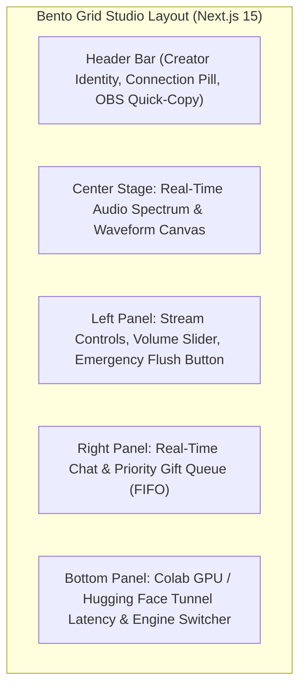

# 💎 Design Specification: Next.js 15 Streamer Dashboard with Apple Liquid Glass Design System

**Date:** 2026-11-05  
**Author:** Antigravity Senior Software Engineer & Capstone AI Systems Architect  
**Project:** TikTok Live Text-to-Speech (TTS) Bot & Cloud Web Platform  
**Target Repository:** [`tiktok-live-tts-bot`](https://github.com/PhuriphatTyPeZ3r0/tiktok-live-tts-bot)  
**Deployment Platforms:** Vercel Global Edge Content Delivery Network (CDN) (Frontend) + Render Free Web Service (Backend) + Google Colaboratory (Colab) Tesla T4 Graphics Processing Unit (GPU) (AI Inference)

---

## 1. Executive Summary & Intent (บทนำและความสำคัญ)

Currently, the TikTok Live Text-to-Speech (TTS) Web Platform serves server-side Jinja2 HTML templates directly from its FastAPI backend. While functional, combining the frontend presentation layer with the long-lived Python Asynchronous Server Gateway Interface (ASGI) ingestion worker creates coupling, risks dashboard downtime during backend restarts, and lacks the fluid, high-fidelity tactile responsiveness demanded by live video creators and streamers.

This specification details the architecture for a decoupled, high-performance **Frontend Single-Page Application (SPA)** built with **Next.js 15 (App Router)**, **TypeScript**, **Tailwind CSS**, and **Framer Motion**, rendered in the **Apple visionOS Frosted Liquid Glass Design System**. 

The frontend will be hosted on **Vercel's Global Edge Network (100% Free Tier, $0/month)**, communicating over secure WebSockets and Hypertext Transfer Protocol Secure (HTTPS) Application Programming Interface (API) calls to the **Render Free Web Service** backend. Real-time neural speech synthesis continues to be powered by the **Fish Speech v1.5** model fine-tuned on the voice of **คุณพิพัฒน์ บุญสิทธิเลิศ (Phiphat Boonsitthilert)** (original Thai voice actor for Yuta Okkotsu).

---

## 2. Design Philosophy & Visual Language: Apple visionOS Liquid Glass

The user interface follows Apple's spatial computing and macOS Sonoma / visionOS aesthetic:

### 2.1 Visual Attributes
- **Multi-Layer Translucent Glass (`LiquidGlass`):** 
  - Base surface: `backdrop-blur-3xl bg-slate-950/40`
  - Foreground cards: `backdrop-blur-2xl bg-white/[0.04]` hoverable to `bg-white/[0.08]`
- **Specular Border Lighting:**
  - Micro-borders: `1px solid rgba(255, 255, 255, 0.12)` with gradient directional highlights (`linear-gradient(135deg, rgba(255,255,255,0.25) 0%, rgba(255,255,255,0.02) 100%)`).
- **Tactile Fluid Physics (Spring Motion):**
  - All button presses, toggles, and modal drawers utilize Framer Motion spring physics (`type: "spring", stiffness: 400, damping: 25`).
- **Ambient Chromatic Glow:**
  - Dynamic radial gradients in the background reacting subtly to audio volume changes and TikTok Live gift events.

---

## 3. Bento Grid Studio Layout Architecture

The user interface adopts a unified **Bento Grid Studio** layout ensuring all mission-critical live stream metrics and controls fit onto a single screen without vertical scrolling:

### 3.1 Component Breakdown
1. **Header Bar (`Navbar.tsx`):**
   - Streamer avatar and TikTok username `@username`.
   - Real-time Connection Status Pill (`Online`, `Reconnecting`, `Offline`) with pulsating indicator.
   - Quick Actions: One-click "Copy OBS Browser Source URL" and "Open Overlay Window".
2. **Real-Time Audio Spectrum Canvas (`AudioVisualizer.tsx`):**
   - HTML5 Canvas powered by the Web Audio API / WebSocket audio stream.
   - Renders animated audio frequencies and oscillating waveforms in real time while Phiphat's voice is being spoken.
3. **Streamer Quick Control Panel (`ControlPanel.tsx`):**
   - Master volume slider (0% to 150%) with decibel meter.
   - Toggle switches: Enable Chat Comments (`enable_comments`), Enable Priority Gifts (`enable_gifts`).
   - Anti-spam cooldown timer display.
   - High-visibility **Emergency Flush (Panic Button)** with confirmation animation to instantly purge the TTS queue via `CONTROL_FLUSH`.
   - **Test Voice Synthesis Button** to trigger live voice verification before going on air.
4. **Live Chat & Priority Queue Feed (`QueueFeed.tsx`):**
   - Displays incoming TikTok Live comments and gifts in real time.
   - Golden accent highlight for VIP Gift events (`priority=True`).
   - One-click Skip button (`Trash2`) and per-user mute action.
5. **Colab / ZeroGPU Acceleration Card (`ColabStatusCard.tsx`):**
   - Shows active tunnel URL (`https://...trycloudflare.com` or `*.hf.space`).
   - Dynamic round-trip latency indicator (e.g., `420 ms (Tesla T4 GPU)`).
   - In-dashboard tunnel URL editor allowing streamers to update their Colab tunnel URL without restarting the backend.

---

## 4. Technical Architecture & Communication Protocols

### 4.1 Technology Stack
- **Framework:** Next.js 15 (App Router with React 19)
- **Language:** TypeScript 5.5+
- **Styling:** Tailwind CSS v3.4 + Tailwind Animate + Custom Glassmorphism plugins
- **Motion & Physics:** Framer Motion 11+
- **Iconography:** Lucide React
- **Audio Processing:** Web Audio API (`AudioContext`, `AnalyserNode`)
- **State Management:** React hooks + Zustand / lightweight React Context

### 4.2 Network & Communication Protocol (WebSocket + REST)
- **WebSocket Gateway (`useDashboardSocket.ts`):**
  - Connects to: `wss://<RENDER_BACKEND_URL>/ws/dashboard/{session_id}?token={admin_token}`
  - Auto-reconnection: Exponential backoff (1s, 2s, 4s, 8s, up to 16s).
  - Handles incoming event types:
    - `EVENT_MESSAGE`: New chat comment queued.
    - `EVENT_GIFT`: Priority gift event announcement queued.
    - `STATUS_UPDATE`: Queue length, current speaking item, active TTS engine (`Fish Speech v1.5 (พิพัฒน์ บุญสิทธิเลิศ)`).
    - `CONTROL_FLUSH`: Queue purged.
- **REST API Endpoints:**
  - `POST /api/settings/colab`: Update Colab tunnel settings.
  - `POST /api/session/test-voice`: Trigger test speech synthesis.
  - `GET /health`: Verify backend availability.

---

## 5. Deployment & Vercel Integration

- Located in: `frontend/` within the repository.
- Configured with `vercel.json` for zero-configuration 1-Click Deployment on Vercel.
- Environment Variables:
  - `NEXT_PUBLIC_BACKEND_URL`: URL of the Render Free Web Service (e.g. `https://tiktok-live-tts-bot.onrender.com`).
  - Fallback: In-app modal prompting streamer to specify their backend URL if not pre-configured.

---

## 6. Voice Model Attribution & Academic Rigor

- **Voice Model Attribution:** Formally attributes voice synthesis to original Thai voice actor **"คุณพิพัฒน์ บุญสิทธิเลิศ (Phiphat Boonsitthilert)"** with backward-compatible alias `"yuta"`.
- **Terminology & Acronyms:** Strictly uses full technical English terms with acronyms:
  - Asynchronous Server Gateway Interface (ASGI)
  - Single-Page Application (SPA)
  - Content Delivery Network (CDN)
  - First-In, First-Out (FIFO)
  - Web Audio Application Programming Interface (Web Audio API)
  - Dual Autoregressive (Dual-AR)
  - Vector Quantization (VQ)
  - Generative Adversarial Network (GAN)
