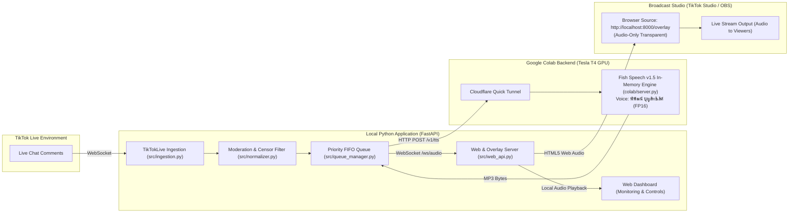

# TikFinity-Style Audio-Only Browser Source & Phiphat Boonsitthilert Voice Engine Design

## 1. Intent & The Why

Streamers on TikTok Live want a frictionless Text-to-Speech (TTS) experience similar to **TikFinity** (`https://tikfinity.zerody.one/tiktok/tts`). Currently, most local TTS bots require complicated Virtual Audio Cable (VB-Audio VAC) driver installations, default Windows playback routing, and microphone configuration in TikTok Studio/OBS.

This design introduces a **TikFinity-style Audio-Only Browser Source Overlay**, enabling streamers to route synthesized speech directly into TikTok Studio/OBS by simply pasting a Browser Source URL. Concurrently, the AI voice personality is officially rebranded and attributed to **"พิพัฒน์ บุญสิทธิเลิศ"** (Phiphat Boonsitthilert), the renowned professional voice actor behind the original voice model, running on a self-hosted Google Colab GPU backend (Fish Speech v1.5).

---

## 2. Goals, Non-Goals, and Anti-Goals

### Goals
- **Frictionless Audio Delivery (No VAC Required):** Provide a web endpoint (`/overlay`) that TikTok Studio or OBS can add as a Browser Source with audio enabled. Synthesized speech plays automatically inside the live stream.
- **Dual Hearing (Monitoring):** The streamer can hear the synthesized comments in their own headphones while simultaneously broadcasting it to the stream viewers.
- **Accurate Voice Attribution:** Rebrand all voice references from "ยูตะ อคคทสึ" to **"พิพัฒน์ บุญสิทธิเลิศ (Phiphat Boonsitthilert)"** across Colab, Web Dashboard, and API contracts.
- **Streamer Controls:** Provide real-time sliders on the Web Dashboard for Volume (0% - 150%) and Speech Speed (0.8x - 1.3x).
- **Automated Text Cleansing & Moderation:** Filter Thai profanity, banned words, and evasive word substitutions before synthesis.

### Non-Goals
- **Visual Screen Clutter:** No intrusive cartoon cards, floating avatars, or subtitles on the live screen; the overlay background is 100% transparent and designed strictly as an audio pipeline bridge.
- **Multi-tenant Cloud SaaS:** This is a self-hosted, personal open-source tool for individual streamers (running locally + Colab GPU), not a paid multi-user subscription platform.

### Anti-Goals
- **Audio Stutter / Echo:** Audio must not play twice or cause feedback loops when monitoring is enabled.
- **Cold Process Delays:** Synthesis must not freeze the live stream. In-memory pre-warmed models ensure latency is < 1.5 seconds.

---

## 3. Architecture & Technical Components

### 3.1 Browser Source Audio-Only Overlay (`/overlay`)
- Route: `GET /overlay` serving a lightweight, zero-dependency HTML/JS page.
- Styling: `body { background: transparent; overflow: hidden; margin: 0; }`.
- Behavior:
  - Connects to `ws://localhost:8000/ws/overlay/audio` (or secure WebSocket over Cloudflare Tunnel).
  - Uses HTML5 `AudioContext` or `new Audio()` with an audio queue to ensure sequential playback without overlaps.
  - Automatically handles browser autoplay policies by resuming AudioContext on the first message or initial load.
  - Obeys volume and playback rate (speed) sent from the server.

### 3.2 Dual Audio Monitoring
- In TikTok Studio / OBS: Browser Source handles broadcast audio to viewers.
- On Streamer PC: If the streamer wants to hear it in their own headphones, the Web Dashboard (`http://localhost:8000`) includes a toggle: **"🎧 ฟังเสียงในหูฟัง (Monitor Audio)"**.
- If enabled, the dashboard plays the same audio stream locally via Web Audio API, or the streamer uses TikTok Studio's native "Audio Monitoring: Monitor and Output".

### 3.3 Voice Model Configuration: พิพัฒน์ บุญสิทธิเลิศ
- Voice ID: `9c110ffde8bc42709516395dfbcfb4a2`
- Voice Name Label: `พิพัฒน์ บุญสิทธิเลิศ (Phiphat Boonsitthilert)`
- Engine: Fish Speech v1.5 (Dual-AR LLaMA + Firefly-GAN VQ-FSQ Codec)
- Precision: FP16 (`torch.half`) on Tesla T4 GPU

### 3.4 Moderation & Filtering Rules
- Thai profanity dictionary with regex-based normalization to catch modified characters, spaced letters, and vowel omissions (e.g. `ค_ว_ย`, `สั_ส`).
- Length boundary: 1 to 80 characters.
- Rate limiting: 15-second cooldown per commenter to prevent spam.

---

## 4. Constraints & Requirements

- All existing 152 automated tests must remain passing.
- Audio playback latency must not exceed 2.0 seconds end-to-end.
- Standalone Git repository with sanitized secrets (`.env` strictly ignored).

---

## 5. What's Left to the Builder

- Exact CSS/HTML implementation of the `/overlay` page and its WebSocket client script.
- The UI controls for Volume and Speed sliders in `templates/index.html`.
- Refactoring voice naming constants in `src/config.py` and `colab/server.py`.

---

## 6. Architectural Rulings from Builder Check (Technical Specifications)

1. **Routing & Session Layer (Hybrid Dual-Layer):**
   - Provide `/overlay` and `/ws/overlay/audio` as static, parameterless convenience aliases mapping to the primary local streamer session (loaded from `.env`).
   - Retain `/overlay/{session_id}?token={token}` for backward compatibility and test isolation, ensuring 100% of existing 152 tests remain green.
2. **Audio Queue & Worker Pipeline:**
   - FastAPI lifespan task runs an asynchronous consumer loop pulling from `TTSQueueManager`, synthesizing via `TTSEngine`, and broadcasting audio payloads to all active overlay WebSocket clients.
   - Sequential playback is enforced client-side via a FIFO `AudioQueue` on the overlay page, ensuring seamless backpressure without blocking server-side ingestion.
3. **Volume & Speed Processing:**
   - Handled client-side in real time via the Web Audio API (`GainNode` for volume 0% - 150%, and `playbackRate` for speech speed 0.8x - 1.3x).
   - Control updates from the Web Dashboard broadcast instant `{"type": "CONFIG_UPDATE", "volume": x, "speed": y}` frames over WebSocket, updating playing and queued audio immediately without cache invalidation.
4. **Dual Hearing & Echo Safeguards:**
   - Monitoring on the Web Dashboard is a purely client-side audio toggle (`AudioContext` or audio element, default muted). A UI banner warns: *"หากเปิดฟังใน OBS/TikTok Studio (Monitor and Output) อยู่แล้ว ไม่ต้องเปิดฟังในหน้าเว็บนี้เพื่อป้องกันเสียงสะท้อนซ้ำซ้อน"*.
5. **Voice Identifier Aliasing & Backward Compatibility:**
   - Both `colab/server.py` and `src/tts_engine.py` accept `"phiphat"` and `"yuta"` interchangeably as aliases pointing to the same voice assets (`colab/assets/yuta_sample.mp3`). The UI display string is standardized to **"พิพัฒน์ บุญสิทธิเลิศ (Phiphat Boonsitthilert)"**.

